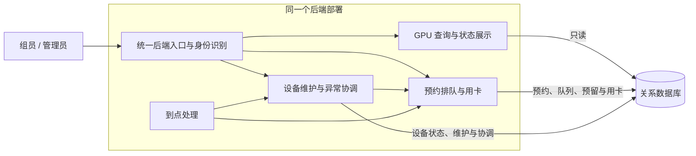
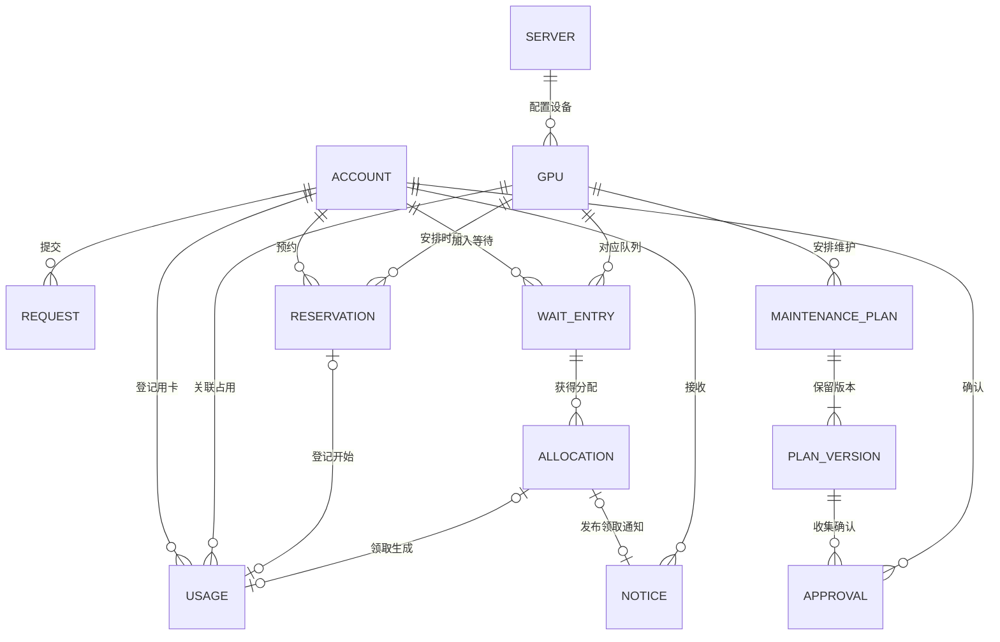

# 课题组 GPU 预约与排队系统架构设计

本架构以定稿的 [PRD](PRD.md) 和 [产品简报](product-brief.md) 为依据，规定三个模块如何共享设备状态、协调写入及处理并发。系统记录预约和用卡状态，组员在 GPU 服务器上自行启动计算任务。

## BMAD 架构讨论过程

本节按对话顺序摘录使用 `$bmad-architecture` 形成本次交付的关键讨论。每轮记录问题、备选方案、项目成员的反馈，以及反馈如何改变架构或验收。原始措辞以对话为准。文末的来源对照可查到每条 ADR 对应的产品简报和 PRD。

### 第一轮 · 先确认模块怎样协作

BMAD 从 PRD §5.2 的 16:00 维护场景提问：领取仍在复检时，维护、排队与查询怎样看到一致的状态？BMAD 提出「同一后端、同一数据库」与「三个服务分别部署、各自持库」两个方案。项目成员追问前两份交付是否已经定过这件事。核对简报和 PRD 后，确认业务模块及协作规则已有依据，部署方式属于本轮决定。项目成员随后确认采用前者，形成 ADR-001。

### 第二轮 · 从并发写入追问预约先后

1. **先处理同一笔预约的竞争。** BMAD 用「取消与登记开始同时发生」比较短事务行锁和版本号条件更新。项目成员选择短事务行锁，沿用 PRD 中先确认的操作生效的规则。
2. **换成两笔新申请再检验。** BMAD 追问两人同时申请 GPU-03 的 14:00–16:00 时要锁什么。两笔申请都可能还没有预约记录，因此提出锁同一张 GPU 的记录，并最初建议以先完成复检并提交成功的一笔为准。
3. **项目成员修改优先规则。** 项目成员指出「谁先提交申请，就是谁」，接着追问「后台处理完成」和「复检」各发生在什么时候。讨论明确了服务器接收申请、核对最新时段、写入并确认的三个步骤。项目成员再次确认先提交的申请优先。架构据此按服务器收到申请的顺序安排复检，通过才确认，失败则轮到后续申请。
4. **把变化写成验收分支。** ADR-002 补充了受理顺序，并在 CONS-01 下增加先到申请复检较慢、先到申请复检失败两种分支。前者检查后到申请是否仍等待，后者检查后到申请是否可以继续。

### 第三至五轮 · 顺着异常场景确认规则

| 轮次 | BMAD 用来引导选择的场景 | 项目成员的确认与文档落点 |
| --- | --- | --- |
| 3 | 系统在 15:59:58 收到领取申请，16:00 维护开始时复检仍未结束。比较后端定期处理数据库记录与独立延迟任务队列。 | 选择后端定期处理。ADR-003 补充暂停扫描后返回迟到复检结果的验收。 |
| 4 | 15:05 的立即使用申请已成功，但用户没有收到响应。比较按申请参数猜测重复与凭请求编号查回原结果。 | 选择唯一请求编号。ADR-004 用原记录和原时段 15:05–15:35 核对结果。 |
| 5 | 兼任管理员可以为自己预约，替他人登记释放则需要额外核实。比较每个接口单独检查与后端统一识别身份、业务操作检查权限。 | 选择统一校验。ADR-005 用本人、他人、管理员和兼任账号做对照。 |

### BMAD 多视角补充讨论 · 已确认保留原受理顺序

分析师 Mary 从用户角度追问，已保存的先到申请如果在复检前遇到系统重启，是否还保有原来的优先权。架构师 Winston 提出从已保存的申请和受理顺序恢复处理。开发者 Amelia 把问题落到可验证的断点，即申请已保存、预约尚未确认时重启。

#### 进阶引导 · 失败情景推演

项目成员同意用 `$bmad-advanced-elicitation` 继续检查这一问题。BMAD 采用失败情景推演（Pre-mortem Analysis），先假设架构在重启时出了问题，再追查原因和应对办法。推演关联 ADR-002 的受理顺序、ADR-004 的原请求重试，以及 PRD 的 FR-029 和 NFR-001。

| 假设发生的失败 | BMAD 追查的原因 | 对应的验收设计 |
| --- | --- | --- |
| 小周的申请已经保存，复检前重启，小林反而先获得同一时段。 | 如果重启后按恢复处理的顺序办理，原来的受理优先权会丢失。 | 在保存小周的申请后、确认预约前中断服务。重启后提交小林的重叠申请。若小周仍满足条件，核对小周先确认，小林收到重叠提示。 |
| 小周的申请一直停在「处理中」，后到的重叠申请也一直等。 | 保留原顺序还需要明确何时结束无法恢复的请求，并让后续申请继续处理。 | 后端在 10:00:00 恢复且可访问数据库，模拟小周的申请到 10:00:30 仍未完成。核对原请求可查到「处理超时」，小林的申请能继续复检。若小周迟到的复检结果随后返回，核对它无法再确认预约。 |
| 预约已经写入，但服务在返回结果前重启，用户重试后出现两笔预约。 | 恢复时若把已成功的请求当成新申请，就可能再次写入。 | 在预约和成功结果提交后、返回响应前中断服务。重启后沿用原编号查询及重试，核对返回原预约与原时段，业务记录只有一笔。 |

BMAD 建议采用 **A**。已经保存且尚未确认的申请按原受理顺序恢复复检。达到约定恢复上限后，仍无法完成的申请记录为失败，后续重叠申请继续办理。备选 **B** 是重启后统一结束尚未确认的申请，用户重新提交并重新排序。B 的恢复流程较简单，但小周可能因为系统中断而失去原来的优先权。两种方案都沿用 ADR-004 对已成功请求的结果恢复规则。

项目成员先追问「重启」指什么。讨论确认，场景指预约系统后端进程退出后重新启动，数据库中已保存的申请仍可读取。项目成员随后选择保留已保存申请的原受理顺序。

BMAD 建议给系统最多 30 秒完成恢复后的复检与确认。项目成员追问这 30 秒是系统检查时间还是用户提交时间，澄清后确认从后端恢复且可访问数据库时起算，由系统处理原申请。ADR-002 记录时限与超时结案，ADR-004 记录原请求编号可查回超时或成功结果。上表的验收设计待实施后验证。

## 系统结构与职责

| 模块 | 职责与写入边界 |
| --- | --- |
| GPU 查询与状态展示 | 读取已提交的设备状态、维护时段、预约、预留和用卡记录，计算可用时段及风险提示。 |
| 预约排队与用卡 | 写入预约、等待、领取资格、预留和用卡记录。统一执行时段复检、确认、取消和释放。 |
| 设备维护与异常协调 | 写入维护方案、故障、恢复和核实记录。需要变更预约、预留或用卡时，在同一事务内调用预约模块的业务操作。 |

### 模块协作与写入边界

| 边界 | 工程约定 |
| --- | --- |
| 查询与提交 | 查卡依据同一套时段、占用和交接规则，返回查询时刻、具体重叠区间、风险原因及联系人。首页卡片按设备不可用、已登记冲突、信息需确认的优先级展示，详情保留全部原因。结果用于判断和填写，提交时仍以最新记录复检。 |
| 申请、改期与用卡 | 预约模块负责提前预约、立即使用、换卡、取消、开始、续用和释放。换卡同时覆盖原卡、目标卡和本人安排。通过复检才一起提交原占用变更与新占用。复检失败保留原预约与输入。 |
| 匹配与通知 | 排队属于预约模块，负责名额、等待顺序、预留和分配结果。「我的等待」展示已确认分配的领取通知。维护故障等站内通知按 PRD 确定的接收人和时点生成，关联业务记录和处理入口。 |
| 维护与协调 | 维护模块负责设备资料、影响预览、方案版本、成员确认、故障及释放核实。设备状态由已生效维护、故障和交接事实共同判断。跨模块生效和代登记通过同一业务操作更新关联安排。 |
| 身份与到点处理 | 后端入口提供已认证账号与角色，写入模块负责校验归属、回避及业务状态。到点处理复用各模块的状态变更规则，记录触发对象、截止时间和结案原因，供重试及验收核对。 |

## 核心数据与关系

这里的实体表示业务记录及归属。账号标识用于绑定申请人、确认人和通知接收人。预约记录、用卡记录与分配记录通过来源关系追溯，统计时同一次占用只计一次。

| 记录 | 维护方 | 需要一起追踪的字段或约束 |
| --- | --- | --- |
| 账号、角色、服务器、GPU | 身份入口维护预配置角色，维护模块维护设备 | 同一账号可兼任组员和管理员。同一服务器下 GPU 标识唯一。型号和登记总显存可补缺，缺总显存的设备单列。 |
| 请求、预约与用卡 | 预约模块 | 请求关联账号、编号、接收时间和结果。预约关联 GPU、组员、确认起止及状态。用卡记录区分登记开始、确认结束、预计结束及其更新时间、实际释放。每次成功的预约开始或领取最多生成一条来源用卡记录。 |
| 等待、分配及领取通知 | 预约模块 | 等待记录保存登记成功时间、序号、申请时长及名额状态。一次等待可以先后产生多次分配。按分配关联预留起止、通知可见时间、领取截止、接收时间及处理结案。 |
| 维护方案、版本及确认 | 维护模块 | 按版本保存原因、时段、受影响成员和变更前后。每次成员确认关联具体版本，生效时以当前版本和最新冲突为准。 |
| 故障、释放核实及站内提醒 | 维护模块记录故障和核实，业务模块生成相应提醒 | 核实关联设备、用卡、受阻预约和已有释放，记录核实人、时间、依据及结论。代办保留原使用者和代办人。站内提醒关联接收人、触发事件及业务入口。 |

## 关键流程与事务边界

### 预约、换卡与并发确认

1. 后端入口收到一笔可识别申请人、请求编号和目标 GPU 的提前预约时，立即将它交给该 GPU 的统一受理入口，按到达该入口的顺序固定受理位置。受理入口逐笔分配递增序号，并将序号、接收时刻、原请求编号和申请内容一起持久化。前一笔的受理结果明确后，才提交下一笔的受理记录。保存结果不明时，先用原请求编号核查。同编号重试复用原序号。该步骤仅登记请求，耗时复检在其后进行。
2. 对同卡重叠的提前预约，最终确认前检查是否有序号更早且未结案的重叠申请。有则保持处理中，等先到申请结案后再复检。即使后到申请先排到执行机会，也按此规则处理。重启后从已持久化的受理记录恢复顺序，按 ADR-002 执行恢复时限，按 ADR-004 查询原结果。
3. 最终确认按 ADR-002 锁定相关 GPU、账号和业务记录，再读取在先申请、维护、预留、同卡占用和本人跨卡确认安排。新预约即使查不到既有占用，也有共同的 GPU 记录可锁。换卡同时纳入原卡与目标卡。若复查发现还涉及未锁定的对象，结束本次事务，按完整范围和既定锁序重新复查。
4. 时段用「含开始、不含结束」的边界比较。前一笔 15:00 结束、后一笔 15:00 开始时，时段本身可以相接。立即使用和领取还须验证实际交接，前序未登记释放、释放待核实、故障或已生效维护均可阻止开始。预计结束只用于风险判断，实际释放才改变交接事实。
5. 关联状态和业务结果一起提交，成功反馈使用提交结果。拒绝时指出原因和具体重叠区间，并保留输入。CONS-01 补测先到申请的受理写入延迟，以及先到申请已保存但后到申请先获得执行机会，分别检查受理序号、复检顺序和唯一生效结果。另测同编号重试保留原序号、本人跨卡重叠、首尾相接、换卡失败保留原预约，以及取消与登记开始的两种确认顺序（FR-006、FR-008 至 FR-010、FR-029，CHANGE-01、CHANGE-07、START-07）。

### 登记开始与截止判断

正常登记截止取预约开始后 15 分钟与原预约结束的较早时刻。系统先保存有效请求的接收时刻，再执行耗时复检。处理截止取接收后 30 秒与原预约结束的较早时刻。自动逾期遇到按时收到且仍在处理时限内的请求时，等待其先结案。最后一次状态检查在确认事务内进行，使用服务端当前时间、最新交接事实和对应请求状态。达到截止时仍未确认的结果不能生成用卡记录。取消先确认时，以取消结案。此处沿用 PRD 的接收与处理时限。提前预约在后端重启后的处理按 ADR-002 的恢复时限办理（FR-009、FR-010、START-07、CHANGE-07）。

### 释放、分配与通知

1. 从「已登记释放且设备可交接」起，用最新空档匹配已有等待，再处理新立即使用。按登记成功时间和序号检查等待。空档须容纳 10 分钟领取窗口和完整使用时长，跳过放不下的申请并保留其顺序。每个组员跨卡最多占一笔等待名额。
2. 释放事务为该释放事件保存唯一的匹配处理记录。设备已可交接时，由预约模块提交后立即发起匹配。仍受阻时，在首次确认可交接后发起。成功分配时，预留、可见领取通知、「待领取」状态和匹配结果一起提交。从「我的等待」首次可见时起算 10 分钟。重复办理同一释放返回原释放时刻，并沿用已有匹配记录。
3. 在截止前收到有效领取请求后进入「领取处理中」。按实际确认时刻复检完整使用时长，包含预留以外的部分。领取和取消竞争时，同一分配只确认一个结果。未领取到期时结束等待并释放名额。已及时领取但收到后满 30 秒仍未确认时，解除预留并保序回队，继续占名额。已生效维护先终结的分配沿用维护结案，迟到结果和旧超时任务按原分配编号核查。
4. 通知确定写入失败时，本次分配无有效预留，原等待保序并保留名额，匹配记录保留待处理状态。预约模块尽快重试，到点处理负责补做漏掉的重试和重启前的未完成匹配。重试沿用释放事件编号，并按 ADR-002 在短事务中核对已有匹配结果、最新空档和交接状态。保存结果不明时先查原分配编号。已有生效分配时沿用原通知和截止。确认原分配未生效后，才允许重新匹配。新立即使用申请也须先检查已有队列。
5. 验收在通知写入失败后验证同一释放事件能恢复匹配，再模拟分配已提交但响应丢失，以及即时重试和到点补做同时发生。核对释放仍有效、同一次匹配只有一笔生效预留和通知、首次可见时刻和截止沿用原结果。NFR-005 从已释放且可交接时计时，重试时间也计入。有合格等待者且超过 5 秒才可见时，记为未达标（FR-013、FR-015 至 FR-021，END-01、END-03、QUEUE-04、CONS-02）。

### 维护版本、故障与权限回避

1. 管理员预览具体重叠区间和受影响记录，保存拟维护或改排方案。挂起期间沿用原安排。修改方案时保留各版本的内容与确认，受新版本影响的组员重新确认。未回复为「待确认」，不同意为「争议」。
2. 请求生效时，复核当前版本、逐人确认及回避条件，再按最新预约、用卡、预留和维护复检。出现新冲突或到拟定起点仍未解决时，方案继续挂起。通过后一起提交改排及维护状态。涉及管理员本人且有其他管理员时转交协调，只有一名管理员也须取得受影响组员确认。
3. 已生效维护到点时暂停匹配及新入队，结束受影响的领取资格，解除预留并保留等待名额和顺序。故障恢复登记后仍要检查释放核实等交接障碍。全部障碍解除且可交接时才恢复匹配。仍有效的受阻预约重算 15 分钟登记宽限期，以原预约结束为上限。已逾期预约按原结案保留。
4. 验收覆盖旧版确认不能用于新版、新预约导致方案继续挂起、兼任或单管理员回避、维护起点收到迟到复检，以及恢复但释放仍待核实。代登记释放用原使用者、代办人、依据和时间核对，有既有释放时另记核实时刻（FR-021、FR-023 至 FR-027，MAINT-01、MAINT-04、COORD-03、AUTH-02 和 PRD §5.2 的 Q-01、Q-02）。

## 架构决策记录

### ADR-001 模块化单体与共享数据

- **适用范围**。GPU 查询、预约排队、用卡、设备维护、异常协调。
- **采用方案**。三个模块统一部署为一个后端，使用一套关系数据库。各模块按「系统结构与职责」所列边界写入。跨模块状态变更在同一事务提交。例如，维护到点处理结束领取、解除预留并标记受影响等待时，查询读取同一次提交后的结果。
- **否决的备选方案**。查询、预约排队、维护各自作为独立服务，并分别持有数据库。
- **否决理由**。维护、领取和解除预留涉及同一张卡，拆库后需要额外处理跨服务同步、消息重试和部分失败。例如，维护已经开始时，领取服务可能仍按旧状态确认用卡。单体部署减少两轮冲刺内的协调工作，代价是模块统一发布。
- **验收依据**。FR-018、FR-021、FR-024，按 PRD §5.2 的 Q-01 从维护、预约和查询三个入口核对结果。

### ADR-002 受理顺序与短事务行锁

- **适用范围**。同卡重叠的提前预约、同一预约的取消和登记开始，以及影响同卡占用的关联写入。
- **采用方案**。同一 GPU 的提前预约由统一入口按接收顺序逐笔受理，递增序号随原申请一起持久化。同卡重叠申请按序号确定复检优先权。先到的申请通过后确认，失败后继续处理后到申请。后到申请与已确认预约重叠时，返回具体重叠时段并保留输入。浏览空档和填写表单期间，时段仍可申请。
- **写入规则**。在短事务中锁定共同的 GPU 记录并复查最新维护、预留及占用。同一申请人的安排可能分布在不同 GPU，涉及本人时段冲突的写入还需对同一申请人串行复检。多记录统一按 GPU、相关账号、预约或分配的顺序加锁，同类记录按 ID 排序。同一预约的取消和登记开始锁定同一条预约，按首次成功确认的结果提交，关联记录在同一事务更新。耗时复检在事务外执行，最终提交前重新验证可能变化的条件。
- **重启恢复**。后端重新启动且能访问数据库后，已保存但尚未确认的提前预约沿用原受理顺序复检。系统从恢复时刻起最多用 30 秒完成复检与确认。先到申请通过则确认，复检失败则继续处理后续申请。到 30 秒仍未确认时，将原申请标为「处理超时」，后续重叠申请可以继续复检。迟到的复检结果不能再确认原申请。
- **否决的备选方案**。按哪个请求先取得锁或先完成复检来分配重叠时段，或用版本号条件更新作为主要并发机制。
- **否决理由**。任务调度或复检耗时可能让后受理的请求抢先。两个新申请也没有共同的预约记录可供版本比较。版本更新发生冲突后，各写入路径仍需重新判断结果，多条关联记录仍需事务。行锁会产生等待，因此确认事务要短，并统一加锁顺序。
- **验收依据**。FR-006、FR-009、FR-010、FR-018、FR-019、NFR-001。按 CONS-01 交换两笔均符合条件的重叠预约的受理顺序，核对仅先受理者成功。另测先到请求复检较慢和复检失败。按 START-07、CHANGE-07 检查预约取消与登记开始的两种确认顺序。另按 CONS-02 检查领取与取消竞争时，单笔分配只产生一个最终结果，关联的用卡、预留及名额一致。

### ADR-003 持久化截止时间与到点处理

- **适用范围**。维护起止、预约登记截止、领取处理截止及恢复后补处理。
- **采用方案**。数据库保存已生效维护时段和业务截止时间。后端周期处理到点记录，重启后补处理。在短事务内复查时刻及状态，重复执行同一任务只结案一次。读查询和写入确认采用服务端时间及已生效维护时段。即使到点任务延迟，维护起点之后也要拒绝迟到的领取确认。按时收到且仍在处理时限内的登记开始请求按 FR-010 等待结案。
- **否决的备选方案**。引入独立延迟任务队列，为每个截止时间投递任务。
- **否决理由**。需要协调数据库事务与任务投递成功，另行解决重复配送、重启补偿和过期消息，增加部署和排查工作。数据库扫描方案仍需用测试确定扫描频率并校验到点后的处理结果。
- **验收依据**。FR-010、FR-018、FR-020、FR-021、FR-024、FR-025、NFR-001。暂停扫描后，在 16:00 维护开始后返回领取复检结果，验证无法登记用卡。恢复扫描后核对预留只解除一次，队列顺序保留。按 Q-02、Q-03 验证故障恢复后的宽限期及登记超时。

### ADR-004 按原请求编号恢复结果

- **适用范围**。提前预约和立即使用的原请求查询及重试。
- **采用方案**。客户端首次提交前生成并保存唯一请求编号，查询和重试沿用该编号。后端按已认证账号及编号建立唯一约束，保存原申请参数和处理状态。处理中返回已有状态，成功时将业务记录和请求结果放进同一事务。相同编号只用于同一笔申请，查询与重试均核对记录归属。
- **重启后的查询与重试**。继续用原请求编号查询已有状态。已保存但尚未完成的提前预约沿用 ADR-002 的受理顺序和 30 秒恢复时限。原申请结案为「处理超时」后，查询或重试返回该结果。若重启发生在成功事务提交后，查询和重试返回同一笔预约及原确认时段。
- **否决的备选方案**。按用户、GPU、申请参数和时间范围查找相似记录，估计是否重复。
- **否决理由**。两次独立申请可能有相同参数。原申请仍在处理时也可能尚未生成可匹配的业务记录。唯一编号需要客户端和后端多保存一项数据，但可以准确查回原来的处理结果。
- **验收依据**。FR-029、NFR-001、APPLY-01、APPLY-02。模拟 15:05 的立即使用申请成功后丢失响应，用原编号并发查询和重试，验证仍返回 15:05–15:35 的原记录，且只产生一笔用卡记录。另测处理中的重试及他人查询被拒。

### ADR-005 统一身份识别与业务权限校验

- **适用范围**。预约取消、管理员代登记、维护协调及兼任账号。
- **采用方案**。后端入口统一提供可信的账号与角色。业务操作校验角色、记录归属及操作条件，对可变条件在写入事务中复查。兼任账号以组员身份操作时享有同样的预约和排队规则。管理员代登记释放须核实且无既有释放登记。已有释放时保留原时间并单独记录核实时刻。调整他人安排须验证当前版本的受影响成员确认并执行管理员回避规则。
- **否决的备选方案**。由各 API 入口独立编写和执行权限与状态检查。
- **否决理由**。同一业务操作通过不同入口调用时，独立实现容易遗漏或产生差异。入口检查后，记录状态也可能在实际写入前变化。统一业务校验需要明确模块职责，但便于维护一套规则和验收用例。
- **验收依据**。FR-026 至 FR-029、NFR-002。按 AUTH-01、AUTH-02、COORD-03 对照本人、他人、管理员和兼任账号，核对越权拒绝后无写入，代登记字段完整，原释放时间可追溯。

## 来源对照与实施验收

| 架构决定 | 产品简报的业务依据 | PRD 的需求与用例依据 |
| --- | --- | --- |
| ADR-001 模块化单体 | §6.1 的三个业务模块，§6.2.4 的跨环节状态及 §6.2.5 的维护协调 | FR-018、FR-021、FR-024 和 §5.2 Q-01 |
| ADR-002 受理顺序与短事务行锁 | §6.2.2 的提交复检与取消，§7.1 的并发用例 | FR-006、FR-009、FR-010、FR-018、FR-019、NFR-001。PRD 要求正常完成的重叠预约恰有一笔成功。本轮讨论进一步明确按服务器收到申请的顺序决定复检优先权。 |
| ADR-003 持久化截止时间 | §6.2.2 的预约登记窗口，§6.2.3 的领取时限，§6.2.5 的故障与维护 | FR-010、FR-018、FR-020、FR-021、FR-024、FR-025 和 §5.2 Q-01 至 Q-03 |
| ADR-004 按原请求编号恢复结果 | §6.2.6 提出的原申请查询与重试建议 | FR-029、NFR-001 和 §5.1 的丢响应、处理中重试及归属用例 |
| ADR-005 统一业务权限校验 | §5.3 至 §5.6 的本人操作边界、调整权限和回避，§7.2 的权限用例 | FR-026 至 FR-029、NFR-002，关联 AUTH-01、AUTH-02、COORD-03 |

### 功能需求追溯

| PRD 编号 | 对应模块或决定 | 可检查的结果 |
| --- | --- | --- |
| FR-001、FR-002 | 查询与设备资料 | 校验查询时段，按单卡登记总显存筛选，缺失总显存的设备单列。 |
| FR-003、FR-004、FR-005 | 查询与提交 | 展示重叠区间、全部已知原因及交接风险。查询失败保留输入，从查询发起申请时重新校验。 |
| FR-006、FR-007 | 预约、换卡与并发确认，ADR-002 | 同卡重叠的提前预约按受理顺序复检。立即使用同时核验交接，刚释放时先检查已有队列。 |
| FR-008、FR-009、FR-010 | 预约确认和登记截止，ADR-002、ADR-003、ADR-005 | 换卡失败保留原预约。取消与登记开始仅有一个结果，按时接收的请求在处理窗口内可继续复检。 |
| FR-011、FR-012 | 预约与用卡 | 预计结束有独立更新时间。续用复检当前安排与同卡有效等待，累计确认时长最多 480 分钟。 |
| FR-013、FR-014 | 释放、分配与通知 | 同笔释放重试返回原时刻。到期未释放保留使用中，按实际受阻情况生成提醒。 |
| FR-015、FR-016 | 释放、分配与通知，ADR-002 | 本人主动入队且跨卡最多占一笔名额，按原登记顺序匹配可交接空档。 |
| FR-017、FR-018 | 释放、分配与通知，ADR-001、ADR-002 | 预留、可见通知和待领取状态一起生效，领取确认时复检完整使用时段。 |
| FR-019、FR-020、FR-021 | 释放、分配与通知，ADR-002、ADR-003 | 区分取消、未领取到期、领取处理超时及维护结案，并核对各自的名额、预留和顺序。 |
| FR-022 | 设备维护与核心数据 | 同一服务器的重复 GPU 标识指向原记录，补填只更新缺失资料。 |
| FR-023、FR-024、FR-025 | 维护版本、故障与权限回避，ADR-001、ADR-003 | 预览可定位影响范围。只有当前版本确认齐全且复检通过才生效。故障恢复后复检交接条件。 |
| FR-026、FR-027、FR-028 | 权限与维护协调，ADR-005 | 核对代登记依据和原释放时间，同时验证角色、归属、成员确认及管理员回避。 |
| FR-029 | 原请求结果，ADR-004 | 同一请求编号查回处理中、超时或原成功结果，重试最多生成一次业务记录。 |
| FR-030 | 模块协作与通知 | 触发和接收对象按 PRD 核对。对应账号可从站内提醒打开相关记录与处理入口。 |

### 非功能需求验收

| PRD 编号 | 核对方法和通过条件 |
| --- | --- |
| NFR-001 | CONS-01 同卡重叠预约 30 轮，交换发起次序并记录受理和确认先后。CONS-02 领取先确认、取消先确认、领取处理中取消先确认各 15 轮。另测取消与登记开始、维护到点、断线重试和重启恢复。重复确认及结果不一致均为 0。 |
| NFR-002 | AUTH-01、AUTH-02 各分支各跑 3 次。越权成功、被拒后仍修改业务状态及代办必填信息缺失均为 0。核对原释放时间、独立核实时刻和接收者可见的提醒。 |
| NFR-003 | 固定 30 个账号、4 台服务器、16 张 GPU、1,000 条预约与用卡记录及 20 条等待记录。10 个账号并发，每人每轮查 20 次，3 轮共 600 次。各轮成功查询 P95 ≤ 2 秒，达到 5 秒计超时，每轮超时和失败均为 0。 |
| NFR-004 | 未参与开发的同学在依赖就绪的干净目录按交付文档操作，60 分钟内完成启动、装载、查询和 10→12→10 分钟窗口变更及复测。12 分钟窗口下，15:00 可见的通知于 15:12 截止。30 分钟申请在 41 分钟空档跳过且保序，在 42 分钟通过时长检查。 |
| NFR-005 | 从释放已登记且 GPU 已可交接起计时。有合格等待者时，5 秒内须在「我的等待」看见 GPU、领取入口与截止时间，重试也计入耗时。无符合条件等待者时，单独记录原因。 |

上述用例均为实施验收计划。实施后按同一交付版本保存初态、请求及业务编号、关键时刻、页面反馈和持久记录，用于核对对应结果。
