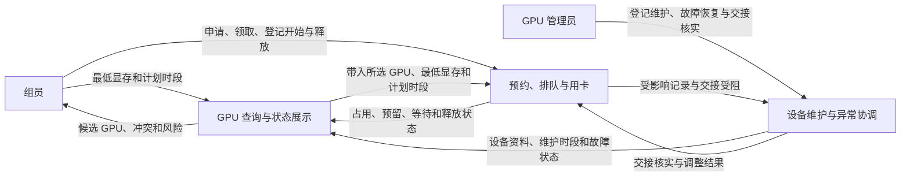
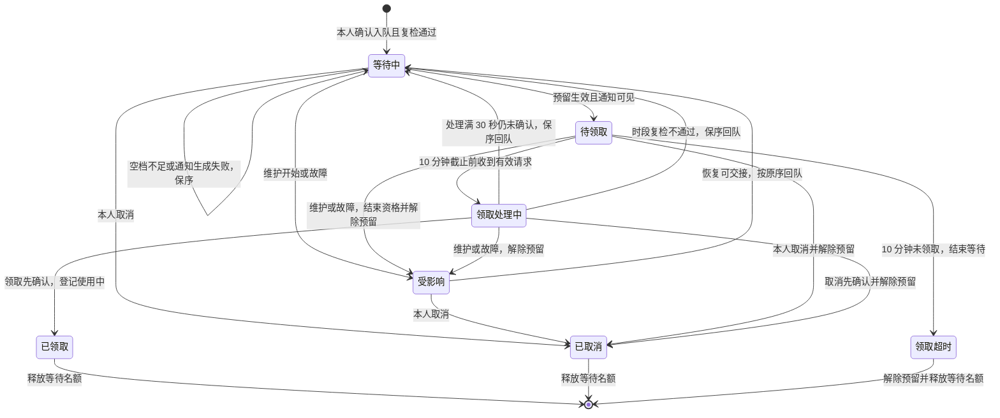
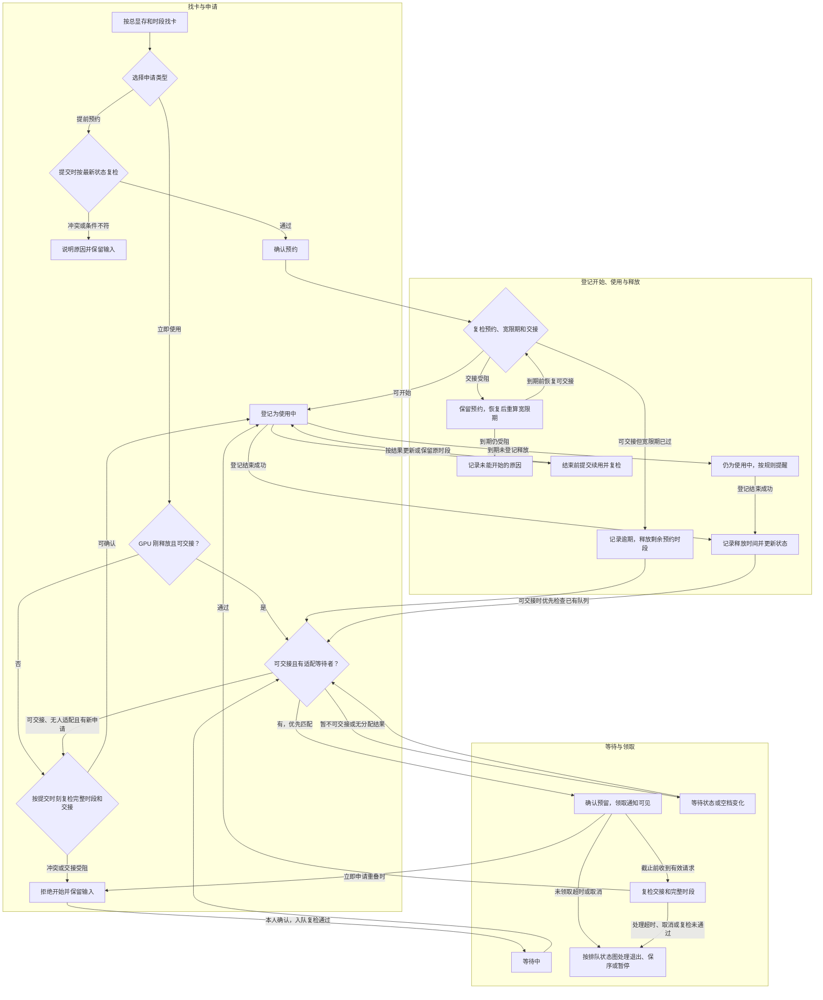

# 课题组 GPU 预约与排队系统｜产品报告分析

本文是第一阶段产品分析报告的正式交付稿。第 1 至 9 节覆盖课程要求的九项内容。三模块的总体与详细功能、业务流程和课程验收目标已采用。仍需业务决定的事项、第一版建议及受影响用例集中见第 6.2.6 节。正式 PRD、架构设计和故事拆分在后续阶段完成。

## 分析状态与证据分类

- **已确认的设计决定**：首要目标是帮助组员判断所需时段有没有已知冲突。等待情况展示与减少反复询问是关联目标。业务规则和详细功能见第 5、6 节。
- **场景假设**：一个课题组有多台服务器及多张不同显存的 GPU。组员运行实验，管理员维护设备并协调冲突和设备异常。文中的人物、日期和数据均为课程案例或测试数据。
- **课程验收目标与实测结果**：第 6 节用例写明预期结果，第 7、8 节列出已采用的课程验收目标和证据要求。实测、模拟和演练结果待执行后填写。
- **已确认的用户与范围决定**：第一版仅面向一个课题组，直接用户为组员（需跑实验的学生和老师）与 GPU 管理员；同一账号可以兼具两种身份。管理员用卡按普通组员规则预约和等待，身份本身不增加用卡优先级；管理职责包括维护设备信息、设置维护状态和处理异常。外部人员、跨课题组共享及访客使用不纳入第一版。
- **已确认的权限与维护决定**：组内共享第 5.2 节列明的必要安排信息，不要求公开实验内容和训练数据；组员只修改、取消自己的申请，改时段重新检查冲突，预计结束更新不等于续用获准。计划维护先展示影响并协调确认，突发故障可先标记不可用、记录原因并通知；原预约和等待记录保留并显示受影响状态。第一版维护操作限于系统内状态管理，服务器任务处置在线下进行。
- **已确认的冲突与自身用卡决定**：普通冲突先按已确认规则处理；改动他人预约或等待顺序须由管理员提出方案，受影响组员确认后执行，并记录原因、前后内容及确认结果。未达成一致时保留原安排、显示争议状态并继续协调。涉及自身用卡时有其他管理员则交由其协调；仅一名管理员时也须取得受影响组员确认，不能自行调整让自己优先。故障后的安排调整同样遵守这些规则。
- **已确认的课程交付约束**：项目至少包含 3 个史诗、12 个用户故事。功能范围分析需兼顾此规模，后续依据确认的需求和架构正式拆分；目前不预设拆分结果，不以拆碎条目代替有业务价值的用户故事。
- **已确认的找卡决定**：按登记总显存筛选，不查实时剩余显存；原找卡输入、字段、分工、时间边界与验收例子已采用。结果显示本次查询时间，刷新或改条件重新查询，申请提交重新检查资源和时段。顶部主要问题按“设备不可用、存在已登记冲突、信息需确认”优先，详情保留全部原因；只有没有发现冲突或风险时才显示“未发现已登记冲突”。具体规定见第 6.2.1 节。
- **已确认的申请规则**：提前预约和立即使用均绑定一张指定 GPU，申请人由登录账号带入，最低显存从找卡条件带入供提交前核对。提前预约与立即使用均在提交时复检，立即使用还须通过设备交接检查。立即使用暂不可满足时，经本人明确选择才登记等待。申请和排队规则见第 6.2.2 至 6.2.4 节。
- **已确认的找卡时间范围**：允许跨日、跨月、跨年，按完整时段检查冲突，结束时间为开始加使用时长。找卡查询沿用原有范围，结果提示是否超出相应申请的时间限制。全部时间统一按北京时间展示。
- **已确认的第一版申请参数**：提前预约的开始时间最远为提交时刻后 7 天，含边界。提前预约、立即使用及由立即使用转入的等待登记均采用单次 480 分钟上限，含边界。参数适用性待实际验证。
- **待核实的实际情况**：真实课题组是否存在类似问题、发生频率、现行协调方式及其实际影响；未来使用计划和任务结束时间的信息是否存在、是否准确及能否共享。尚未提供访谈、资源配置、使用记录或管理制度；不得将假设案例表述为真实调研结论。
- **课程设计内待讨论的问题**：身份管理、设备资料维护、部分确认与争议边界、非领取类通知、并发及异常反馈等，集中列于第 6.2.6 节。预计值由使用者维护，较旧阈值为 2 小时课程参数，实际适用性待验证。

## 1. 项目背景分析

### 1.1 选题动机

用户希望课题组的 GPU 使用安排更清楚，使组员方便地找到合适的卡，并了解接下来是否有人使用，减少在群里反复询问和协调的时间。这是课程设计的出发点，实际改进幅度尚待验证。

### 1.2 假设使用环境及参与者

课程场景设定为一个课题组，共享多台服务器及多张不同显存的 GPU。组员使用 GPU 跑实验，日常用卡自行协调；管理员主要负责服务器、账号及设备维护，遇到冲突时协助处理，平时不专门汇总每个人的使用计划和等待需求。这是对现有场景的假设，不等同于未来系统的角色权限设计。具体人数、资源数量及系统权限待讨论。

### 1.3 假设问题情境

组员准备运行两小时训练，发现一张显存足够且当前空闲的 GPU，询问后才得知半小时后已有其他人计划使用；另一张 GPU 正在运行任务，但组员不知道何时结束，只能继续询问并等待消息。

该情境由用户作为假设案例提供。重复协调及实验安排困难是场景中的预期影响，尚无实际数据证明其发生频率、严重程度及因果关系。

### 1.4 当前原因探索（课程假设）

- **后续安排的信息分散**：某个组员知道自己何时需要使用 GPU，但计划散在群聊和私下约定中；其他组员查询服务器时只能看到当前状态，仍需询问相关人员。
- **沟通方式的形成和延续**：课题组早期用卡人数少，口头约定能够安排使用；准备实验时在群里或私下询问，方便且能较快联系到同学。人数增加后仍沿用原有习惯，后续安排分散在不同聊天中，新来的同学也不容易找全。
- **现有协调分工**：管理员主要维护服务器、账号和设备，冲突发生时协助处理；日常用卡由组员自行协调，没有专门汇总个人使用计划及等待需求。准备使用的人先查卡、再去群里询问，仍需各自找消息、联系同学。该分工不等同于管理员失职，也不能据此推定未来应由管理员负责汇总。
- **任务结束时间不确定**：使用者可能有大概估计，但训练可能提前结束，也可能因调试或重跑而延长。
- **延长后可能延后告知的原因**：使用者可能正忙于调试，以为十几分钟后就能结束，打算确定后再说，却又重跑；也可能不知道后面谁在等待，认为需要用的人会主动询问。每次预计时间变化都在群里发消息，还可能被使用者视为打扰大家，最终等别人询问才解释。这些为可能并存的原因，并非所有使用者都会如此，也未确定各原因的影响程度。
- **等待需求表达不完整且可见范围有限**：等待者可能在群里说“用完叫我”、私信使用者，或只定期查卡而未明确表达等待。使用者可能只知道其中一个等待者，其他组员也看不到完整等待情况。所需显存、预计使用时长及是否已换卡往往未一起说明。这些描述尚不能推出存在稳定的排队顺序，也没有确认应如何登记或排序。

当前原因链为：

1. 后续安排难以了解 ← 信息散在不同聊天和私下约定中、缺少汇总 ← 小规模时方便有效的习惯在人多后继续沿用，日常协调仍由组员各自承担。
2. 变化未及时被他人知晓 ← 使用者可能延后告知 ← 结束时间反复变化、等待对象不明确、依赖他人询问及群消息打扰顾虑。
3. 等待对象和需求不明确 ← 等待者表达渠道不同，部分人未表达，显存、时长和是否仍在等待等信息不完整 ← 当前依靠分散的个人协调，没有专门汇总等待需求。

以上链条为用户提供的课程假设整理，不作为已验证的根本原因，也不意味着已穷尽所有原因。

集中登记的持续使用率和预计时间更新的及时性需在真实使用中验证。课程方案采用使用者自行更新预计值、组员主动加入等待，见第 6.2.2、6.2.3 节。

### 1.5 初步问题分析充分性检查

课程假设已覆盖参与者、协调过程、计划信息分散、更新滞后、等待需求不可见及预计结束时间不确定，可作为第 2 节目标和第 3 节问题重述的依据。

问题频率、实际耗时、影响程度及因果关系需通过真实调研验证。课程案例的登记责任、预约约束、等待排序和异常处理见第 5、6 节。

## 2. 项目目标

### 2.1 首要目标（已确认）

帮助组员了解 GPU 的使用安排，优先判断所需时段有没有已知冲突，以及大概什么时候能用，使其能够决定是否等待某张卡或调整实验时间。

### 2.2 关联目标（已确认）

- 展示等待情况，为判断哪张卡值得等待、何时可能使用提供辅助依据。展示与等待规则见第 6.2.1、6.2.3 节。
- 减少围绕使用安排的反复询问和协调，服务于首要目标；不要求消除所有人工沟通。实际减少幅度尚待验证。

### 2.3 初步目标达成场景（用户确认，课程假设）

组员准备运行两小时训练，输入最低显存要求和计划使用时段后，能查看显存等已讨论条件相符的候选 GPU、已登记的后续安排，以及当前使用者填写的预计结束时间和更新时间。符合显存条件的候选卡仍可能存在时段冲突，不能将“符合条件”直接表述为“全时段可用”。

- 一张 GPU 当前空闲，但半小时后有人计划使用：组员能够看出该已登记安排与两小时训练存在冲突，该空闲窗口不足以覆盖计划时段。
- 另一张 GPU 预计一小时后释放，后续没有已登记的冲突：组员能够据此决定等待或调整实验时间，但预计释放与无已登记冲突不构成可用性保证。
- 预计结束时间未填写、信息较旧或任务延长导致预计释放风险时：页面明确提示需要再联系使用者确认。预计值由使用者维护，时效与风险规则已整理至第 6.2.1 节，尚未承诺自动检测服务器任务变化。

该场景用于第 8.4 节的课程模拟验收。查询反映登记信息及已知风险，实际交接在开始使用前复检。

## 3. 问题重述

**问题描述（用户已接受，依据为课程假设）**：在假设的课题组环境中，GPU 后续使用计划分散在群聊和私下约定中，组员查看服务器当前状态时，难以同时了解相关安排；正在运行的任务结束时间又存在不确定性。因此，组员难以依据现有信息评估满足显存要求的 GPU，在所需完整时段内是否存在已知冲突，以及何时可能可用，需要额外询问和协调。

集中展示使用计划、预计结束时间及更新时间，预期能够改善判断依据，但其效果取决于信息是否完整、是否及时更新，以及相关使用规则。当前不据此承诺完整时段必然可用；沟通成本和实验安排受影响的程度，仍待实际验证。

**苏格拉底提问检查及已采纳的边界**：

- 查询只能依据已登记的计划。实际登记完整性待验证。
- 更新时间用于判断估计是否较新。估计的准确性及使用者更新的及时性待验证。
- 以已确认时段和有效待领取预留判断登记冲突。预计结束时间供参考，设备能否交接按最新登记检查，见第 6.2.4 节。

第 1.4 节用 Five Whys 梳理沟通习惯、协调分工和等待需求的原因链。苏格拉底提问检查形成上述三项边界。角色视角讨论形成第 5 节的权限和维护边界。

### 3.1 方案比较（课程场景，实际效果待验证）

以判断单张 GPU 是否有已知时段冲突、前一位是否已登记释放、查询后是否出现新的占用为比较依据。

| 做法 | 组员可用的判断依据 | 信息变化后的处理 |
| --- | --- | --- |
| 群聊和私下沟通 | 使用者的消息、口头约定及最新回复。可直接联系使用者确认释放，安排可能分散在不同对话 | 由组员查找消息、核对先后顺序并重新询问 |
| 共享表格 | 集中填写 GPU、计划起止时间、使用者和预计结束时间。若同时填写状态与更新时间，也可供人工核对释放 | 按本次比较假设，表格由组员手动登记和检查重叠。提交前需要重新查看或联系当事人确认变动 |
| 本课题拟设计的预约系统 | 同一查询结果提供已确认时段、有效待领取预留、释放登记、预计结束及更新时间，并显示当前已知风险 | 提交按最新登记复检。立即使用另查设备能否交接，时段冲突时说明依据并保留输入 |

真实课题组的信息登记完整性、更新及时性、组员判断效果和额外询问次数待验证。第 8.4 节采用课程模拟验收检查页面判断。

### 3.2 反向多视角检查（规则已采用）

采用 `bmad-advanced-elicitation` 的 Inversion Analysis 和 Stakeholder Lens Rotation。从查卡组员可能误判的情形出发，分别核对组员看到的页面、当前使用者或排队者的记录，以及系统提交时的判断。

| 反例 | 采用的规则 | 验收依据 |
| --- | --- | --- |
| 前一位确认用卡至 15:00，15:05 尚未登记释放，最新预计结束为 15:10，查询 15:15–16:15 无时段重叠 | 找卡提示「信息需确认」，详情说明「确认时段已结束，尚未登记释放」并显示当前使用者。提交立即使用时仍未释放或无法交接，拒绝登记开始并保留输入 | FIND-21、APPLY-10 |
| 查卡无冲突，提交前已为其他组员生成有效待领取预留 | 提前预约和立即使用都按最新记录复检。重叠时显示「待领取预留」及具体重叠区间，保留输入。实际结果待测试 | FIND-17、APPLY-05、APPLY-12 |

## 4. 目标用户

### 4.1 第一版用户范围（已确认的设计决定）

第一版仅服务一个课题组，直接使用系统的人包括组员和 GPU 管理员。组员包括需要跑实验的学生和老师；未依据学生、老师身份另设用卡优先级或权限规则。外部人员、跨课题组共享和访客使用不纳入第一版，见第 9 节。

| 身份 | 使用目的与职责 | 已确认边界 |
| --- | --- | --- |
| 组员 | 了解 GPU 使用安排，判断所需时段的已知冲突及大概可用时间，按第 6 节规则预约和等待 | 可查看第 5.2 节规定的组内信息；只修改、取消自己的申请；修改使用时段重新检查冲突；预计结束更新不授予续用权 |
| GPU 管理员 | 维护设备信息、设置维护状态、处理异常、提出冲突调整方案 | 管理身份不增加用卡优先级；维护遵循第 5.4 节，系统内不处置服务器任务；调整他人预约或等待顺序须经受影响组员确认，涉及自身用卡遵循第 5.6 节 |

### 4.2 身份兼任与流程分析依据（已确认的设计决定）

- 同一个账号可以同时具备组员和管理员身份，管理员也可能使用 GPU 跑实验。
- 兼任者用卡时按普通组员规则预约和等待，管理身份不带来额外用卡优先级。
- 兼任者履行管理职责时可维护设备信息、设置维护状态及处理异常。是否需要显式切换身份、身份如何授予与撤销，尚未决定。
- 维护影响、普通冲突和自身用卡的处理原则见第 5.4 至 5.6 节，执行步骤见第 6.2.5 节。
- “正在使用”“准备使用”“正在等待”描述组员的使用情境，目前不据此新增身份或权限类别。

本节为用户明确指定的课程设计决定，不代表对真实课题组人员构成和授权制度的调研结论。

## 5. 业务需求分析

### 5.1 已确认的业务约束

- 第一版服务范围限于一个课题组，直接用户范围遵循第 4 节。
- 同账号可兼具组员与管理员身份；管理员使用 GPU 时按普通组员规则预约和等待，管理员身份本身不增加优先级。
- 管理员可维护设备信息、设置维护状态及处理异常；修改他人预约或等待顺序遵循第 5.5 节的提出方案与受影响组员确认规则，服务器任务处置不在第一版系统操作范围内。

### 5.2 组内信息查看范围（已确认）

- 组内可查看使用者姓名、GPU、使用时段、预计结束时间和更新时间，供判断安排及联系本人使用。
- 实验内容和训练数据无需公开或作为申请必填项。验收证据按第 8.2 节留存。

### 5.3 组员申请操作边界（已确认）

- 组员只能修改、取消自己的申请，不能以普通组员身份修改或取消他人申请。
- 同一组员可以持有多笔已确认的用卡安排，各安排时段不能重叠。提交时同时检查目标 GPU 的占用和申请人自己的已确认时段，具体例子见第 6.2.2 节。
- 预约开始前可修改自己的预约，包括换卡。提交时复检目标 GPU 的总显存、设备状态、时段冲突、预约限制和本人其他已确认时段。通过后一次完成新预约的确认和原时段的释放。失败时说明原因，保留原预约和新输入。预约仍有效且尚未登记开始时可取消，包括已到预约开始时间的情况。取消成功后释放剩余预约时段，取消与登记开始同时提交时以系统先确认的操作为准。
- 修改预计结束时间仅更新估计值，不自动延长已申请的使用时段，也不产生优先使用权。
- 已登记开始使用后关闭普通修改和取消。提前用完可通过“结束使用”登记释放 GPU，仍可更新预计结束时间。延长须另行申请，通过后才延长确认时段。
- 到预约开始时间尚未登记开始时，按第 6.2.2 节的宽限期处理。前序占用、故障或释放待核实导致无法交接时，全部阻碍解除后再起算，截止不晚于原预约结束时间。续用和释放也见第 6.2.2 节。

### 5.4 设备维护与既有安排（已确认）

| 维护类别 | 处理原则 | 既有安排与系统边界 |
| --- | --- | --- |
| 计划维护 | 先展示影响。与已确认预约重叠时，保存拟维护方案，由管理员协调并取得受影响组员的确认 | 待确认或争议期间保留原预约，拟维护暂不参与冲突检查。取得全部所需确认并复检通过后，一次完成预约调整和维护生效。详见第 6.2.5 节 |
| 突发故障 | 可先把设备标为不可用，记录原因并通知相关组员 | 原预约与等待记录保留，显示受影响状态，供后续处理；不静默删除，也不据此自动改排 |

- 第一版维护操作限定为系统内的状态管理。服务器上的任务处置由管理员在线下完成，系统不执行中止、暂停或迁移训练任务等操作。
- 维护影响须在既有预约和等待记录上可见。恢复与重新安排见第 6.2.5 节，提醒渠道见第 6.2.6 节。
- 已确认设备基础字段包括所属服务器、具体 GPU 标识、型号和总显存，由管理员维护；其他设备字段、编辑流程及约束仍待细化。

### 5.5 普通冲突与调整权限（已确认）

- 普通用卡冲突按第 6 节确认的预约、续用和队列排序规则处理。
- 需要改动他人的预约或等待顺序时，由管理员提出调整方案，受影响的组员确认后再执行。仅说明原因或发出通知不能替代确认。
- 记录调整原因、变更前后的内容和确认结果。
- 未达成一致时保留原安排，显示争议状态并继续协调；不自动赋予管理员单方裁决或改排权限。
- “保留原安排”不代表故障设备可以继续使用：设备不可用状态与安排保留、争议状态应区分。争议对新申请和开始使用的具体影响，留待相应流程讨论。
- 计划维护的确认、未回复、方案变更与生效前复检见第 6.2.5 节。普通争议仍需细化的边界见第 6.2.6 节。组员未回复时保留原安排。

### 5.6 涉及管理员自身用卡（已确认）

- 有其他管理员时，交由其他管理员协调。
- 只有一名管理员时，也须取得受影响组员确认，不能自行调整使自己获得优先。
- 管理员仍可按突发故障规则先标记设备不可用、记录原因并通知相关组员；受影响的预约与等待记录保留，后续调整遵守第 5.5 节的规则。
- 管理身份和故障处置均不授予自身插队或自动改排的权利；组员身份下修改自己的申请仍遵守第 5.3 节。

### 5.7 角色与权限阶段小结及完整性检查

**已覆盖的主要边界**：直接用户及人员范围、同账号身份兼任、组内信息可见范围、自有申请操作、估计与续用权的区分、计划维护与故障处置、调整他人安排的授权及确认、未达成一致的处理、自身用卡利益边界、系统状态管理与线下任务处置的分界。

跨环节的状态判断见第 6.2.4 节，操作权限验收见第 7.2 节。账号与设备维护等仍需决定的细节见第 6.2.6 节。

## 6. 功能需求分析

### 6.1 总体功能设计（已采用）

以下是用户确认的三组功能及业务交接。找卡结果反映查询时的登记状态，提交申请时按最新状态复检。组员从查询结果进入申请时，可以沿用选中的 GPU、最低显存和计划时段。

| 模块 | 使用者 | 完成什么 | 向其他模块提供什么 |
| --- | --- | --- | --- |
| GPU 查询与状态展示 | 组员和 GPU 管理员 | 按登记的单张 GPU 总显存和计划时段找卡。显示查询时间、设备资料、确认安排和待领取预留的重叠区间、等待人数、维护或故障状态，以及预计结束、更新时间和未释放等风险。按已确认的优先级展示主要问题 | 组员选定 GPU 后，将所选设备及查询条件带入预约或立即使用。申请模块使用最新登记信息复检 |
| 预约、排队与用卡 | 组员。兼任管理员者用卡时按普通组员规则办理 | 提交提前预约或立即使用，按权限调整或取消本人预约，加入或退出队列，匹配空档并生成预留和站内领取通知，领取或登记开始，更新预计结束时间，申请续用及登记释放 | 向查询提供已确认时段、有效预留、等待人数、使用与释放记录、预计结束时间及其更新时间。向维护与异常协调提供受影响的预约和等待、交接受阻及到期未释放等记录 |
| 设备维护与异常协调 | GPU 管理员。受影响的组员参与核实与确认 | 维护设备资料，安排计划维护，登记故障及恢复，核实交接受阻，协调使用争议。涉及调整他人预约或等待顺序时，由管理员提出方案，受影响组员确认后执行并留存记录。未达成一致时保留原安排及争议状态 | 向查询提供设备资料、维护时段、故障状态和原因。向预约、排队与用卡提供设备可用与可交接的登记结果、受影响范围和已确认的调整结果，供复检、暂停和恢复匹配使用 |

**总体功能关系图**

**释放与队列匹配**

组员完成“结束使用”登记后，用卡记录转为“已结束”，系统记录释放时刻并更新查询。GPU 可以交接时，按当时的连续空档先检查已有队列，匹配最早登记且能放入 10 分钟领取窗口和完整用卡时长的组员。匹配后确认临时预留，同时在「我的等待」显示站内领取通知。查询随生效预留更新，重叠的申请按最新状态复检。队列无人符合条件时，再复检新提交的立即使用申请。

**维护和故障对查询及申请的影响**

- 查询展示维护时段或故障原因，受影响的预约和等待按既定规则保留。已登记不可用优先展示，详情保留其他已知冲突和需确认信息。
- 提交预约或续用时复检目标时段是否与维护、故障状态或其他安排冲突。提前预约登记开始、立即使用、排队领取统一复检设备能否交接。前一位未登记释放时，哪怕没有预约重叠，也会阻止本次开始并说明原因。
- 计划维护前仍可匹配能完整放入领取窗口及申请时长的等待记录。空档截止取维护开始和下一笔已确认预约开始中的较早时刻。设备不可用期间暂停匹配和通知，受影响的等待保留名额及原顺序。设备恢复且可交接后，按原顺序和当时的空档重新匹配。

三个模块的详细需求均已审阅，见第 6.2.1 至 6.2.6 节。课程要求为至少 3 个史诗、12 个用户故事，依据后续需求与架构阶段成果正式拆分。

### 6.2 详细功能需求

各模块按使用者、前置条件、输入、处理流程、输出、异常情况和验收例子组织。第 5 节规定权限和业务约束。预计结束时间的查询展示见第 6.2.1 节，维护操作及验收见第 6.2.2 节。

#### 6.2.1 GPU 查询与状态展示（详细需求已采用）

验收例子 FIND-01 至 FIND-21 均采用课程假设。FIND-20 覆盖故障恢复与复检，FIND-21 覆盖确认时段已到但尚未登记释放。

##### 一、使用者

- 本课题组组员和 GPU 管理员可查询。组员包括需要运行实验的学生和老师。
- 同时具有管理员身份的组员找卡时遵循普通组员规则，不增加优先级。
- 外部人员、跨课题组共享及访客使用不在第一版范围内。

##### 二、前置条件

- 查询者已登录并具备本课题组组员或 GPU 管理员身份。准入和认证的待决定事项见第 6.2.6 节。
- 查询依据系统内登记的设备资料、使用安排、使用登记、维护状态及预计结束信息。各字段责任见输出部分，不接入实时剩余显存查询。
- 不以“至少登记一张 GPU”或“所有资料完整”作为可查询的前提：无设备、资料不完整应分别进入对应反馈。
- 第一版日期和时间统一按北京时间展示。查询需要的输入满足下述规则后执行。

##### 三、输入

| 输入 | 已确认规则 |
| --- | --- |
| 最低显存 | 必填，单位 GB，数值大于 0，允许小数；按管理员登记的单张 GPU 总显存筛选 |
| 开始方式 | 选择“立即开始”或“指定时间” |
| 立即开始 | 每次查询取当前时间为本次开始时间；再次查询重新取值，不沿用旧时刻 |
| 指定时间 | 提供包含日期和时间的有效值；已过去时提示重新选择，由用户决定是否切换为立即开始，不自动切换 |
| 预计使用时长 | 必填，单位分钟，正整数；0、负数、小数及非数值均不符合规则 |

**时间范围（已确认）**

- 结束时间由本次开始时间加预计使用时长计算，完整显示起止日期和时间。
- 允许跨日、跨月和跨年；午夜不是切断查询或已登记安排的边界。
- 找卡阶段暂不设置“最远查询日期”和“单次使用时长”的业务上限。
- 查询结果按第 6.2.2 节提示本次时段是否超出相应申请的时间限制。指定未来时段按提前预约规则提示开始时间窗口及单次时长，立即开始按立即使用的单次时长规则提示。正式提交以提交时刻重新校验的结果为准。

##### 四、处理流程

1. **接收并校验输入**：检查必填、格式及数值规则。错误在对应字段旁说明，保留已填内容，修改正确后再执行查询；输入错误不进入“没有匹配 GPU”的反馈。
2. **确定本次查询时段**：根据开始方式取得开始时间，计算结束时间；结果展示本次实际采用的完整起止时间。指定开始已过去则返回重选提示。
3. **读取登记信息**：读取设备资料及相关安排、使用登记、维护状态、预计值与其独立更新时间。无设备、显存资料缺失、读取失败分别处理。
4. **筛选显存条件**：登记总显存大于或等于最低要求的 GPU 进入匹配候选。缺总显存资料的设备单独列为“资料待补充”，由管理员确认后才能判断，不能当成显存不足。
5. **检查已登记时段冲突**。按完整起止时间检查重叠，跨午夜的安排也参与检查。首尾相接不重叠，不额外预留交接时间。查询开始早于安排结束，且安排开始早于查询结束时存在重叠。有效待领取预留和已确认预约分别列出重叠时段。
6. **分别检查设备问题、释放状态与预计信息风险。** 维护、故障、确认时段已到但尚未登记释放、预计晚于计划开始、预计值缺失或较旧、预计已到但未释放等情形均说明原因。即使查询时段与登记时段没有重叠，也保留对应提示。
7. **生成并展示结果**。显示本次查询时间和实际采用的起止时间，结果反映查询时的登记状态。显存匹配卡即使有问题也保留。顶部按设备不可用、已登记冲突、信息需确认的顺序突出主要问题，详情保留全部原因。仅当没有发现冲突或风险时显示“未发现已登记冲突”。
8. **处理反馈与再次查询**：无正常结果按异常分类反馈。查询失败显示失败与重试入口、保留条件；用户刷新或修改条件时重新查询。立即开始每次重查重新取得当前时间。本次查询时间与预计值独立更新时间分别显示，不能混用。
9. **衔接申请提交**。从查询结果进入申请时，带入选中的 GPU、最低显存和计划时段，供组员核对。指定时段对应的开始日期时间和使用时长可沿用到提前预约。立即使用沿用 GPU、最低显存和使用时长，计划开始仍取提交时刻。提交时复检见本节“从找卡进入申请”。

**判定与提示规则（已确认）**：

| 条件 | 结果要求 |
| --- | --- |
| 查询与已登记安排有时间重叠 | 明确指出存在已登记冲突，显示冲突时段；匹配卡仍保留 |
| 查询与有效待领取预留或已确认预约重叠 | 在冲突详情分别标出预留重叠和预约重叠。顶部仍按已确认的优先级展示主要问题 |
| 没有发现登记时段重叠，且没有其他已知冲突或风险 | 才显示“未发现已登记冲突”，仍不保证全时段实际可用 |
| 无登记时段重叠，但存在设备问题或信息风险 | 不显示“未发现已登记冲突”作为查询结论；按主要问题提示，详情仍可说明登记时段与查询没有重叠这一事实 |
| 当前使用者预计结束晚于计划开始，存在预计释放风险 | 若无更高优先级的设备不可用或已登记冲突，顶部显示“需确认，可能无法按计划开始”；详情保留时段差异、预计值更新时间和使用者姓名 |
| 仍登记正在使用，距预计值最近一次更新达到 2 小时 | 提示“信息较旧，需联系确认”，显示具体更新时间；恰好 2 小时也触发 |
| 已到达或超过预计结束，但尚未登记释放 | 在信息需确认类中优先提示“预计结束时间已到，实际是否释放待确认”，无需等到 2 小时；若有更高等级问题，顶部突出该问题、详情保留本原因 |
| 查询时已到确认结束时间，仍登记为使用中且尚未登记释放 | 即使预计结束时间尚未到、早于查询开始，且没有登记重叠，仍归为「信息需确认」。详情显示「确认时段已结束，尚未登记释放」及当前使用者。有设备不可用或已登记冲突时，顶部按原优先级显示，详情保留本原因 |
| 使用中记录未填写预计结束 | 显示“未填写，需联系确认”，不虚构预计值或更新时间 |
| 维护或故障导致设备不可用 | 醒目显示不可用及原因，保留候选；相关预约、等待记录按维护规则保留 |
| 当前已登记故障且恢复时间未知，查询未来时段 | 卡片顶部显示“设备不可用”，详情显示“当前故障，恢复时间待确认”。管理员登记恢复后，重新查询时按最新设备状态和该时段的安排判断。提交申请时再次复检 |
| 确认联系人缺失 | 显示“待确认”，不编造联系人；无法联系后的处理待细化 |

预计信息的时效判断针对仍登记为正在使用的记录，不要求无当前使用者的 GPU 虚构预计结束信息。2 小时为课程设计参数，其实际适用性待验证。预计值修改只改变估计，延长使用仍须另外申请，预计已到不自动等于登记释放。

**多问题展示优先级（已确认）**：设备不可用 > 存在已登记冲突 > 信息需确认。顶部突出最高优先级的已知问题，详情保留全部原因和对应时段、更新时间、姓名等依据。该优先级是展示规则，不赋予任何申请抢占或优先使用权。

例如，组员在 13:50 查询 GPU-A 的 14:00–16:00。设备计划 15:00–16:00 维护，已有 14:30–15:00 的确认预约。当前使用者确认用卡至 14:00，在 13:45 更新预计结束为 14:20。卡片顶部显示“设备不可用”。展开后可同时看到维护时间和原因、预约重叠的 14:30–15:00、预计结束 14:20 晚于计划开始 14:00，以及预计值的更新时间与确认联系人。若设备不可用原因解除，预约重叠仍存在，顶部显示“存在已登记冲突”。若只剩预计释放风险，顶部显示“需确认，可能无法按计划开始”。

##### 五、输出

**结果整体**：显示本次查询时间及实际采用的起止日期和时间，统一北京时间。结论与原因按上述优先级展示，详细安排可展开。结果同时提示是否超出相应申请的时间限制，供组员在提交前调整。

| 必须信息 | 来源与更新责任 |
| --- | --- |
| 所属服务器、具体 GPU 标识、型号、总显存 | 管理员登记和维护 |
| 当前登记状态 | 系统根据使用安排、开始与释放登记、维护和故障记录形成。各状态对时段及交接的影响见第 6.2.4 节 |
| 等待人数 | 按该 GPU 当前为“等待中”的记录统计，仅供参考。等待记录本身不占查询时段 |
| 待领取预留和已确认预约 | 时段详情分别显示类型和起止时间。存在重叠时分别显示具体重叠区间 |
| 与查询时段重叠的已登记安排、使用者姓名及使用时段 | 组员维护自己的安排；改动他人安排遵循管理员提出方案、受影响者确认及留痕规则 |
| 当前使用者填写的预计结束时间 | 当前使用者填写、修改 |
| 预计结束信息的更新时间 | 系统独立记录，仅在该预计值被填写或修改时更新；其他字段修改不能让旧预计值变新 |
| 信息不足时的确认联系人 | 使用安排问题联系对应使用者；设备维护问题联系管理员；无法确定时显示“待确认” |

当前安排即使没有与查询重叠，但构成预计释放风险的依据，也应在风险详情中呈现。实验内容和训练数据不用公开。“没有登记时段重叠”是可说明的事实，但只有没有发现冲突或风险时才展示“未发现已登记冲突”这一结论；不能据此保证实际可用。

**从找卡进入申请（已确认的交接）**

| 情况 | 带入与提交结果 |
| --- | --- |
| 从结果进入提前预约 | 带入所选 GPU、最低显存、计划开始日期时间和使用时长，供组员核对。提交时按第 6.2.2 节复检 |
| 从结果进入立即使用 | 带入所选 GPU、最低显存和使用时长。计划开始取本次提交时刻，按该时刻起的完整时段和设备交接条件复检 |
| 查询后新增已确认预约 | 提交时检查到重叠则暂不确认申请，说明与已确认预约冲突，标出具体重叠时段并保留填写内容 |
| 查询后新增有效待领取预留 | 提前预约和立即使用均按提交时最新记录复检。重叠时明确标出「待领取预留」和具体重叠区间，保留输入并暂不确认。立即使用可同时提示「当前空档已为等待组员预留」，由组员决定是否等待 |

组员可以换卡、调整时段后重新提交。预留解除后，组员也可以主动重提，系统重新检查最新预留、其他安排、开始时间与申请限制。

##### 六、异常情况

| 异常 | 已确认处理 |
| --- | --- |
| 必填缺失、格式错误或数值非法 | 对应字段旁说明原因、保留输入，修改正确后再查询；不显示成零匹配 |
| 指定开始时间已过去 | 提示重新选择，不擅自切换立即开始 |
| 没有登记设备 | 显示“暂无已登记 GPU”，提示联系管理员 |
| 已知总显存都不足 | 显示“未找到总显存满足要求的已登记 GPU”，允许改条件；资料未知设备仍单列 |
| 缺少显存资料 | 单独列为“资料待补充”，管理员确认后再判断是否匹配 |
| 预计值缺失、较旧、已到但未释放 | 按判定表提示，保留实际更新时间、姓名和已知安排等依据 |
| 联系人缺失 | 显示“待确认”，不填入猜测信息 |
| 匹配候选全部有冲突或风险 | 保留候选及具体原因，支持用户决定修改条件、换时段或联系确认 |
| 查询失败 | 显示失败与重试入口，保留已填条件；失败不能产生“未发现已登记冲突”的结论 |

多种设备资料情况可以分别反馈，不用一条“没有可用 GPU”抹掉未知信息。多问题展示优先级已确定，具体状态、争议及等待记录对判定的影响仍在本节末跟踪。

##### 七、验收例子（课程假设，尚未运行测试）

以下均为课程假设数据，不是实际资源或测试结果。除另有说明，查询时刻为北京时间 2026-11-13 10:00，最低显存 16 GB，指定开始为当日 14:00，时长 120 分钟；查询者具有组员身份，设备与记录可读取。各例独立，未写出的资料完整，无额外维护、故障、争议或使用中记录。仅有“未发现已登记冲突”不得显示成保证可用。

| 编号与类别 | 条件或操作 | 预期结果 |
| --- | --- | --- |
| FIND-01 正常查询 | 最低 16.5 GB，指定 2026-11-13 14:00，时长 120 分钟；服务器 S1 的 GPU-A 总显存 24 GB、GPU-B 为 16 GB，无冲突或使用中记录 | A 匹配、B 不匹配；完整显示 2026-11-13 14:00—2026-11-13 16:00，展示必要设备与登记信息；A 显示“未发现已登记冲突”，不承诺可用 |
| FIND-02 立即开始与重查 | 选择立即开始、120 分钟；10:00 查询，10:05 再查询 | 第一次结果为当日 10:00—12:00，第二次为 10:05—12:05；显示完整日期和时间，不能沿用第一次时刻 |
| FIND-03 已登记冲突 | 查询 2026-11-13 14:00—16:00；匹配卡已有安排 14:30—15:30 | 卡保留，醒目标出冲突及 14:30—15:30 的完整日期时间，详情可查看使用者和安排 |
| FIND-04 首尾相接 | 查询 2026-11-13 15:00—17:00；已有安排 14:00—15:00；另测查询 12:00—14:00 | 两次均不构成登记时段重叠；不额外添加交接间隔。另有未释放或维护提示时仍保留 |
| FIND-05 跨日冲突 | 查询 2026-11-13 23:30、120 分钟；已有安排 2026-11-13 23:50—2026-11-14 00:20 | 查询结束为 2026-11-14 01:30；识别与跨午夜安排的冲突，完整显示两端日期 |
| FIND-06 跨月、跨年及无找卡业务上限 | 查询 2026-11-30 23:30、120 分钟；另测 2026-12-31 23:30、120 分钟，以及 2027-01-10 12:00、10080 分钟 | 分别结束于 2026-12-01 01:30、2027-01-01 01:30 和 2027-01-17 12:00；不因找卡的最远日期或单次时长业务上限而拒绝。不得据此声称这些时段已经允许预约 |
| FIND-07 信息较旧的等号边界 | 当前仍登记使用中，预计当日 18:00 结束，预计值更新时间当日 08:00；另测更新时间 08:01，查询时刻均为 10:00 | 08:00 距查询恰好 2 小时，提示“信息较旧，需联系确认”并显示时间；08:01 尚未达到，不因该阈值产生较旧提示，其他风险仍独立判断 |
| FIND-08 预计结束已到但未释放 | 当前仍登记使用中，预计当日 10:00 结束，尚未释放，预计值更新于 09:50；另测预计 09:59 结束 | 10:00 查询时，两例均优先提示“预计结束时间已到，实际是否释放待确认”，即使更新时间未达到 2 小时；不自动登记释放 |
| FIND-09 预计释放风险与登记冲突分开 | 本例查询时刻为当日 14:30；已登记使用 14:00—15:00；当前使用者预计 15:30 结束、更新于 14:20；查询 15:10—17:10 | 顶部“需确认，可能无法按计划开始”；详情说明登记时段无重叠但预计晚于查询开始，显示预计值更新时间和使用者姓名；更新预计不授予续用权 |
| FIND-10 预计值或联系人缺失 | 存在使用中记录但未填预计结束；另测无法确定确认联系人 | 分别显示“未填写，需联系确认”和“待确认”，保留已有安排与可提供的姓名，不编造信息或视为可用 |
| FIND-11 显存资料缺失 | 一张卡未填总显存，其他已知显存均低于最低要求 | 未知卡单独列为“资料待补充”，由管理员确认；已知不匹配可反馈不足，不能将未知卡一并判为不足 |
| FIND-12 未登记与显存不足 | 分别测试设备列表为空、存在完整设备资料但全部总显存不足 | 前者显示“暂无已登记 GPU”并提示联系管理员；后者显示“未找到总显存满足要求的已登记 GPU”，允许改条件 |
| FIND-13 输入错误 | 分别提交最低显存空白、0、负数、非数值；时长空白、0、负数、1.5 或非数值；指定日期时间缺失或格式无效 | 在对应字段旁说明原因，保留其他输入，改正确后才查询；不能显示成零匹配。最低显存 16.5 不因是小数而报错 |
| FIND-14 指定过去时间 | 10:00 查询时指定当日 09:59 开始 | 提示重新选择，保留输入，不自动改成 10:00，不自动切为立即开始 |
| FIND-15 查询失败 | 输入合法，读取登记信息失败 | 显示失败与重试入口，保留条件；不得显示“未发现已登记冲突”作为失败查询的结论；若原选立即开始，重试按新查询时刻计算 |
| FIND-16 全部候选有问题 | 已知显存匹配的候选分别存在冲突、维护或故障、预计释放风险 | 候选均保留，展示各自主要问题和依据，信息不足提示不丢失；不笼统改成空列表 |
| FIND-17 查询时间、带入及提交复检 | 13:00 查询 GPU-A 的 14:00–16:00 未发现冲突。分两次独立验证 13:05 新增 14:30–15:30 的确认预约，或新增 13:05–14:35 的待领取预留且领取通知在 13:05 可见。组员从原结果进入提前预约，13:06 提交 | 申请带入 GPU-A、最低显存、14:00 开始和 120 分钟。第一种提示与确认预约重叠 14:30–15:30。第二种提示“该时段与待领取预留重叠，暂不能预约”，标出 14:00–14:35。两种均不确认申请，保留输入。刷新或改条件后按最新记录展示，并更新查询时间 |
| FIND-18 多问题优先级 | 13:50 查询 GPU-A 的 14:00–16:00。设备 15:00–16:00 维护，预约 14:30–15:00。当前使用者确认用卡至 14:00，在 13:45 更新预计结束为 14:20。分别再测无设备不可用、仅剩预计释放风险和全部无问题 | 首次顶部显示“设备不可用”。详情保留维护时段和原因、预约重叠时段、预计结束时间及更新时间和确认联系人。其余情况依次显示“存在已登记冲突”“需确认，可能无法按计划开始”和“未发现已登记冲突” |
| FIND-19 等待人数与两类时段重叠 | 15:05 查询 15:40–16:10。GPU-A 有 2 条“等待中”记录、15:00–16:00 的有效待领取预留及 16:00–18:00 已确认预约。领取通知在 15:00 可见 | 卡片显示“2 人等待”。详情分别显示“15:40–16:00 与待领取预留重叠”和“16:00–16:10 与已确认预约重叠”。顶部继续按设备不可用、登记冲突、信息需确认的优先级展示主要问题 |
| FIND-20 故障恢复时间未知及恢复后复检 | 11 月 13 日，GPU-A 已登记故障且恢复时间未知。查询 11 月 14 日 14:00–16:00。管理员随后登记恢复，组员重新查询，分别验证该时段有 15:00–16:00 的已确认预约、以及无冲突或风险两种情况。无冲突例在提交前再次登记故障 | 首次顶部显示“设备不可用”，详情显示“当前故障，恢复时间待确认”。恢复后重查，有预约例显示 15:00–16:00 的重叠，无冲突或风险例显示“未发现已登记冲突”。无冲突例提交时识别新增故障，说明原因并保留输入，申请不确认 |
| FIND-21 确认时段已结束且尚未释放 | 前一位确认用卡至 15:00，15:05 仍未登记释放，最新预计结束为 15:10，且预计值刚更新。15:05 查询 15:15–16:15，无预约或预留重叠，设备无维护或故障 | 顶部提示「信息需确认」，详情显示「确认时段已结束，尚未登记释放」和当前使用者。随后在 15:15 提交立即使用时若仍未释放，按 APPLY-10 拦截并保留输入 |

FIND-17 同时检查立即使用的带入。以 13:00 的“立即开始”查询进入申请，在 13:06 提交时仍沿用所选 GPU、最低显存和时长，并以 13:06 为计划开始进行复检。

查询展示当前已生效的预留和确认时段。领取处理中超出原预留的拟用时段，确认成功后才成为已确认时段，见第 6.2.4 节。查询结果按第 6.2.2 节提示申请时间限制。查询性能见第 7.3 节，展示细节和联系人缺失后的处理见第 6.2.6 节。

#### 6.2.2 申请、使用与释放

##### 提前预约与立即使用（详细需求已采用）

**使用者和前置条件**

本课题组组员使用登录账号提交本人申请，兼任 GPU 管理员者按组员规则申请。每笔申请绑定一张已登记的 GPU。组员可从找卡结果进入申请，提交时以最新登记状态检查。

**输入**

| 字段 | 提前预约 | 立即使用 |
| --- | --- | --- |
| 申请人 | 由登录账号带入 | 由登录账号带入 |
| 目标 GPU、最低显存 | 带入选中的 GPU 和找卡时的最低显存，供本人核对 | 同左 |
| 开始时间 | 填写开始日期和时间，可沿用查询时段的开始时间 | 取申请提交时刻 |
| 预计使用时长 | 可沿用查询条件，以正整数分钟填写，范围为 1–480 分钟 | 同左 |

日期和时间按北京时间展示，结束时间由开始时间加预计使用时长得到。申请表单提前提示适用的 7 天预约窗口及 480 分钟时长限制。实验内容和训练数据无须填写。

**处理与输出**

1. **校验申请条件。** 核对申请人、目标 GPU 和时段。提前预约的开始时间已过去时提示重选。预约开始最远为提交时刻后 7 天，包含该边界，结束时间可越过窗口。两类申请均按单次 480 分钟上限检查。
2. **按最新登记信息复检。** 检查目标 GPU 的资料和状态、完整申请时段与维护、有效预留或已确认安排是否冲突，以及本人是否已有其他重叠的确认时段。首尾相接不算时段重叠。预计结束值用于提示风险，登记交接按实际登记状态检查。
3. **提前预约通过时确认时段。** 系统直接确认预约，页面显示 GPU 和确认起止时间，无需管理员逐笔审批。到预约时，组员按本节已确认的开始登记流程复检交接。
4. **立即使用通过时登记开始。** 复检提交时刻起的完整时段和设备是否可交接。GPU 刚登记释放且可交接时，先检查已有队列，队列无人符合当前空档的分配条件才复检新的立即使用申请。通过后直接登记为“使用中”，显示“已登记开始”、GPU 标识和确认结束时间，组员自行到服务器启动任务。若尚未启动任务就决定不用，也按已确认的“结束使用”流程登记释放。
5. **立即使用暂不可满足时反馈原因。** 当前有人用卡、前一位尚未登记释放或当前连续空档太短时，可以提示组员选择等待。保留输入。组员主动点击“加入等待”时，按第 6.2.3 节复检 GPU、申请时长和本人等待名额，通过后才登记等待。

**异常与反馈**

| 情况 | 系统反馈与保留内容 |
| --- | --- |
| 缺失、格式或取值错误，预约开始已过去，或超过窗口与时长限制 | 指出具体字段或超过的限制，保留已填内容，供修改后重新提交 |
| 目标 GPU 维护或故障 | 显示设备不可用的原因及相关时段，保留输入。管理员登记恢复后，重提仍按最新状态复检 |
| 查询后新增已确认预约或有效待领取预留，且与申请重叠 | 两类申请均说明冲突类型及具体重叠区间。提前预约遇有效预留时提示「该时段与待领取预留重叠，暂不能预约」。立即使用遇有效预留时提示「当前空档已为等待组员预留」，同时显示类型「待领取预留」和具体重叠区间。各情形均保留输入，申请暂不确认 |
| 本人已有其他重叠的已确认安排 | 指出本人的已有安排和具体重叠区间，保留输入供调整，即使两笔使用的是不同 GPU |
| 立即使用时前一位尚未登记释放，或释放待核实 | 暂不登记开始，保留申请内容。前一位未释放时提示“前一位尚未登记释放，暂无法开始”。待核实时说明待确认的原因和联系人。即使申请时段没有预约重叠也执行交接检查。GPU 可交接后，先检查已有队列，再判断新的立即使用申请能否确认 |

预约与等待的详细状态规则、预约修改或取消、领取、续用及释放见本节下文和第 6.2.3 节。

**验收例子**

以下为课程假设。每例独立，除特别说明外，账号属于课题组、选定 GPU 已登记且资料完整，其他时段和权限检查均通过。FIND-17 继续覆盖从查询带入条件及提交时复检。

| 编号 | 条件或操作 | 预期结果 |
| --- | --- | --- |
| APPLY-01 提前预约成功 | 11 月 13 日 10:00 从找卡选中 GPU-A，最低显存 16 GB，预约次日 14:00 使用 120 分钟 | 带入 GPU、最低显存、开始时间和时长，账号带入申请人。复检通过即确认并展示 GPU-A 和次日 14:00–16:00 |
| APPLY-02 立即使用成功 | 10:00 查询后选择 GPU-A，使用 120 分钟，10:06 提交。设备可交接，队列没有符合条件者 | 以 10:06–12:06 复检，通过后直接登记为“使用中”。页面显示“已登记开始”、GPU-A 和确认结束时间 12:06 |
| APPLY-03 申请时间与时长边界 | 11 月 13 日 10:00 提交，分别测试 11 月 20 日 10:00 与 10:01 开始。对两种申请分别测试 480 和 481 分钟 | 第 7 天同一时刻与 480 分钟通过对应校验，预约结束可越过窗口。10:01 或 481 分钟超限时指出具体原因，保留输入 |
| APPLY-04 输入缺失或时间已过去 | 10:00 提交提前预约，分别遗漏开始时间、指定 09:59 开始、填写 0 或 1.5 分钟 | 指出对应字段或开始时间错误，保留输入，无预约确认 |
| APPLY-05 查询后新增预约或预留 | 按 FIND-17 两次独立验证。另在 15:05 提交 15:40–16:10 的提前预约，目标 GPU 有 15:00–16:00 的有效预留，通知在 15:00 可见 | 按提交时最新状态识别冲突。预留例显示类型「待领取预留」和 15:40–16:00，保留输入。预留解除后，主动重提仍检查新预留、其他安排及开始时间 |
| APPLY-06 本人时段冲突与首尾相接 | 小林已有 GPU-A 14:00–16:00 的预约，12:00 分别申请立即使用 GPU-B 120 分钟和 180 分钟 | 120 分钟在 14:00 相接，通过时段检查。180 分钟与本人 GPU-A 预约重叠 14:00–15:00，提示区间并保留输入 |
| APPLY-07 维护、故障和交接 | 分别验证拟预约时段与维护重叠、FIND-20 中提交前设备再次故障、前一位确认至 16:00 却未释放且小陈 16:05 提交立即使用 | 前两种按当前设备状态提示原因并保留输入。第三种即使没有预约重叠，也提示“前一位尚未登记释放，暂无法开始”，不登记开始 |
| APPLY-08 释放时的队列优先 | GPU-A 刚登记释放且可交接，空档为 60 分钟。小陈申请立即使用 30 分钟。分别验证小周等待 50 分钟和 90 分钟，且无其他符合条件的等待者 | 50 分钟加 10 分钟领取窗口能放入空档，先为小周预留。小陈看到待领取预留及其与申请的重叠区间，输入保留。90 分钟不适配，小周保序，复检通过后可确认小陈的立即使用 |
| APPLY-09 立即使用转等待 | GPU-A 暂无法立即使用，组员先查看失败原因，再明确确认等待 | 查看原因后尚无等待记录。本人确认并符合等待条件后才登记，所选 GPU 和时长沿用原申请 |
| APPLY-10 时段无重叠但交接受阻 | 前一位确认时段 15:00 结束，15:05 仍未登记释放。验证 15:05 立即提交的场景，再按 FIND-21 查询 15:15–16:15，并在 15:15 提交立即使用，前一位仍未释放。两次拟用时段均无预约或预留重叠 | 提示「前一位尚未登记释放，暂无法开始」，拒绝登记开始并保留输入。GPU 可交接后，先检查已有队列，再复检新的立即使用申请 |
| APPLY-11 主动加入等待并复检 | 分别验证 GPU 当前有人用卡、前一位未释放、眼前空档太短。组员看到等待选项后点击“加入等待”。另分别测试提交时目标 GPU 校验未通过、时长无效或为 481 分钟、本人已有占名额的等待 | 点击前无等待记录。点击时复检 GPU、时长和本人等待名额。输入有误或超限时提示修改，名额已占时提示可先取消原等待。通过后显示“已加入等待”，预计释放时间仅供参考 |
| APPLY-12 查询后新增预留与立即使用重叠 | 14:59 查卡无冲突，组员从该结果进入立即使用。15:00 系统为另一位组员生成待领取预留 15:00–16:00 且通知可见。15:05 预留仍有效，申请人提交使用 30 分钟 | 按 15:05–15:35 和最新有效预留复检。显示冲突类型「待领取预留」和实际重叠区间 15:05–15:35，保留 GPU、最低显存和时长，且不登记开始。组员可修改或在预留解除后主动重提，重提时再次复检 |

提交结果不明时的重试反馈见第 6.2.6 节。

**预约窗口与单次时长（已确认的课程设计参数）**

- 提前预约的开始时间最远为提交时刻后 7 天，包含第 7 天同一时刻。以预约开始时间为准，预约结束时间可超过窗口，仍需符合单次时长限制。
- 提前预约、立即使用共用单次 8 小时上限，恰好 480 分钟可以提交。立即使用转为等待时，登记的申请时长沿用该上限。两个参数的实际适用性待验证。
- 申请表单提前提示适用限制。超出限制时指出具体原因并保留已填内容，供组员调整。提交时依据当前时刻和登记信息复检。找卡结果提示是否超出申请时间限制，超限时段仍可查询。

**边界例子（课程假设）**

| 情境 | 预期反馈 |
| --- | --- |
| 11 月 13 日 10:00 提交，预约 11 月 20 日 10:00 开始、使用 480 分钟 | 通过时间限制校验，结束时间为 11 月 20 日 18:00，仍需通过设备及冲突检查 |
| 同一提交时刻，预约 11 月 20 日 10:01 开始 | 说明开始时间超过 7 天窗口，保留输入供修改 |
| 提前预约、立即使用或转等待的登记时长为 481 分钟 | 说明超过 480 分钟上限，保留输入供修改 |
| 查询上述超限时段 | 继续查询和展示登记安排，结果提示对应的超限原因 |

**同一组员持有多笔已确认安排（已确认）**

- 同一组员可以持有多笔已确认的用卡安排，任意两笔的用卡时段不能重叠，即使使用不同的 GPU。首尾相接不算重叠。
- 提交提前预约或立即使用申请时，同时检查目标 GPU 的占用及申请人自己的已确认时段。本人时段重叠时，指出已有安排及重叠时段，保留新申请输入供组员修改。
- 等待记录是否限笔数、排到后如何复检，留到排队环节。

课程假设为小林已确认预约 GPU-A 的 14:00–16:00，于 12:00 申请立即使用 GPU-B。

| 新申请 | 预期结果 |
| --- | --- |
| 12:00–14:00，GPU-B 可用且满足其他申请规则 | 通过。两笔时段在 14:00 首尾相接 |
| 12:00–15:00，GPU-B 本身可用 | 不通过。提示与本人在 GPU-A 的预约重叠，指出重叠为 14:00–15:00，并保留输入，供组员缩短时长或调整时间 |

##### 提前预约的修改与取消（详细需求已采用）

**使用者与前置条件**

课题组组员通过本人账号操作自己的已确认预约。预约开始前可修改，包括直接换卡。预约仍有效且尚未登记开始时可取消，包括已到预约开始时间的情况。兼任管理员者修改自己的用卡预约时同样遵守组员规则。维护和争议导致的他人预约调整按第 5 节的协调确认流程处理。

| 操作 | 输入 | 处理 | 输出 |
| --- | --- | --- | --- |
| 修改预约 | 选中本人的原预约，可修改开始日期、时间、时长或目标 GPU | 提交时核对本人权限、预约仍在开始前，以及目标 GPU 的登记总显存、设备状态、时段冲突、预约限制和本人其他确认时段。比较时排除原预约自身，计入有效待领取预留 | 全部检查通过后一次完成新预约的确认和原时段的释放。显示目标 GPU 和新确认时段。失败时说明原因，涉及时段重叠则标出重叠区间，保留原预约和本次输入 |
| 取消预约 | 选中本人的原预约并提交取消 | 复检本人权限、预约仍有效且尚未登记开始。取消成功将记录标为“已取消”，释放当时剩余的预约时段 | 显示取消结果，查询随生效安排更新。若前一位尚未释放，等 GPU 可交接后，再按当时的连续空档及队列规则匹配 |
| 已登记开始使用 | 查看本人的使用中记录 | 普通修改和取消关闭。提前结束使用“结束使用”登记释放，预计结束时间可更新，延长须提交续用申请 | 结束使用以登记成功时刻记录释放。更新预计结束值用于提示。续用通过后更新确认结束时间 |

**异常与反馈**

- 修改时若超出预约限制、目标 GPU 有冲突或本人其他确认安排重叠，显示原因并保留原预约和本次输入。
- 若打开表单后预约已经登记开始，提交修改或取消时按最新状态检查，原预约和使用状态保持，页面说明已开始使用及对应操作入口。
- 取消和登记开始同时提交时，以系统先确认的操作为准。取消先确认时，后续登记开始因预约已取消而无法通过。登记开始先确认时，取消不生效，组员通过“结束使用”登记释放。

**验收例子（课程假设）**

| 编号 | 条件或操作 | 预期结果 |
| --- | --- | --- |
| CHANGE-01 修改成功 | 小林于 12:00 将 GPU-A 的 14:00–16:00 预约改为 15:00–17:00。新时段与原预约部分重叠，其他检查均通过 | 原预约本身不构成冲突。替换后显示 GPU-A 和 15:00–17:00，查询按更新后的安排判断占用 |
| CHANGE-02 修改失败保留原预约 | 小林于 12:00 将 GPU-A 的 14:00–16:00 预约改为 15:00–17:00，但 GPU-A 已有他人 16:30–17:30 的已确认预约。另测本人在另一张卡已有重叠安排 | 分别指出目标卡或本人安排的冲突及具体重叠时段。原 14:00–16:00 预约仍有效，本次修改输入保留 |
| CHANGE-03 取消并释放时段 | 小林于 12:00 取消本人 GPU-A 的 14:00–16:00 预约。另测 GPU 当前已可交接，已有等待记录 | 显示取消成功，14:00–16:00 不再由该预约占用。设备已可交接时，以当时的连续空档按队列规则重新匹配 |
| CHANGE-04 登记开始后尝试修改或取消 | 小林已登记开始，或在他打开修改表单后登记开始，再尝试普通修改或取消 | 页面提示已开始使用，普通修改或取消不生效。可通过“结束使用”登记释放、更新预计结束时间，或另行申请续用 |
| CHANGE-05 开始前换卡 | 将 GPU-A 的 14:00–16:00 预约改到 GPU-B。分别验证 GPU-B 总显存、设备状态、时段、预约限制、本人其他安排全部合规，以及其中一项复检失败 | 全部通过后一次完成 GPU-B 的预约确认和 GPU-A 原时段释放。失败时指出原因，保留 GPU-A 的原预约和本次输入 |
| CHANGE-06 到点后取消 | 小林的预约为 14:00–16:00，14:05 预约仍有效且尚未登记开始，提交取消。另测前一位仍未登记释放 | 显示取消成功，原记录标为“已取消”，14:05–16:00 可重新安排。前一位仍未释放时，等 GPU 可交接后再匹配 |
| CHANGE-07 取消和登记开始同时提交 | 对同一有效预约并行提交取消和开始，分别验证两个先后结果 | 取消先确认时，登记开始不通过。开始先确认时，取消不生效，组员可用“结束使用”登记释放 |

##### 预约登记开始（详细需求已采用）

**使用者、前置条件与输入**

课题组组员使用本人账号，选中自己的有效提前预约并点击“开始使用”。系统从预约读取组员、服务器、GPU 和原确认起止时间。预计结束时间选填，可在登记时填写，也可开始后补填或更新。

**处理与异常**

1. 按最新登记信息核对预约归属、有效状态、登记时间窗口和 GPU 是否可交接。预约已取消或已经超过有效登记窗口时，不能登记开始。取消与开始并发时，按 CHANGE-07 的规则处理。
2. 设备在原预约开始时可交接，登记截止取“原开始时间加 15 分钟”和“原结束时间”中较早的一项。以系统收到请求的时刻判断是否在截止前。截止前收到可继续复检，通过后登记开始。恰好到截止才收到且设备已经可以交接时，提示宽限期已过，按逾期规则释放剩余预约时段。
3. 交接受阻时保留预约，说明阻碍。前一位未登记释放时显示“前一位尚未登记释放，暂无法开始”。设备故障时标为“受影响”并显示原因。释放待核实时显示待确认的原因和联系人。
4. 在原预约结束前恢复可交接时，从所有相关阻碍解除的时刻起重新计算 15 分钟，截止仍以原结束时间为上限。恢复后到截止仍未登记，按普通逾期处理。阻碍持续到原结束时，按原因登记未能开始。存在多个阻碍时记录“因交接受阻未能开始”，详情保留全部原因。

**输出**

登记成功后，系统关联原预约、组员和 GPU，保留原预约起止时间，记录系统确认登记的时刻，并将用卡状态更新为“使用中”。页面显示“已登记开始”、服务器、GPU 标识、登记开始时间和确认结束时间，保留“更新预计结束时间”和“结束使用”两个入口。预计结束时间选填。填写后与确认结束时间分别展示，并显示预计值更新时间。预计值未填写时，组内查询显示“未填写，需联系确认”。组内查询同步更新使用状态及可见信息。

**验收例子（课程假设）**

除另有说明外，小林预约 14:00–16:00，预约属于本人。各例独立。

| 编号 | 条件或操作 | 预期结果 |
| --- | --- | --- |
| START-01 一般宽限期 | GPU 在 14:00 可交接，14:10 登记。另测到 14:15 仍未登记，以及原预约仅为 14:00–14:10 | 首例可开始，确认结束仍为 16:00。第二例标逾期并释放剩余时段。短预约以 14:10 截止，宽限期不超出原结束时间 |
| START-02 前一位未释放 | 前一位到 14:20 才登记释放。另测到 15:55 才释放，或到 16:00 仍未释放 | 释放前提示无法开始。14:20 释放后可在 14:35 前登记，15:55 释放后只可在 16:00 前登记。持续到期未释放则记录“因前序占用未能开始” |
| START-03 故障和释放待核实 | 设备 14:20 恢复，释放在 14:25 核实完成。另分别验证仅故障、仅释放待核实、两者同时持续到 16:00 | 14:25 后才可交接，登记截止为 14:40。若单项持续到期，分别记录“因设备故障未能开始”或“因释放未确认而未能开始”。两项同时持续则记录“因交接受阻未能开始”并保留两个原因 |
| START-04 重新起算后逾期 | 14:20 恢复可交接，到 14:35 仍未登记开始 | 按普通逾期处理，释放剩余预约时段。队列能否匹配仍按最新设备状态及空档判断 |
| START-05 成功记录和展示 | 前一位 14:20 释放，小林 14:28 通过复检。分别测试填写预计结束 15:45 和留空 | 保留原预约 14:00–16:00，记录 14:28 为登记开始并更新为“使用中”。显示服务器、GPU 标识、开始时间和“确认用卡至 16:00”。填报时另显 15:45 及更新时间，留空时组内查询提示“未填写，需联系确认”。本人可更新预计值或登记结束，组内查询同步 |
| START-06 资格及状态复检 | 使用他人的预约或已取消的预约尝试开始。另验证取消与登记开始同时提交 | 他人预约或已取消预约不能登记。并发按 CHANGE-07 处理，页面与组内查询只反映实际生效的结果 |
| START-07 恰好到登记截止 | 小林预约 14:00–16:00。设备 14:20 恢复，前一位释放在 14:25 核实完成，登记截止为 14:40。分别验证系统在 14:39:59 和 14:40:00 收到开始请求，设备此时可交接 | 14:39:59 收到可继续复检，通过后登记开始，确认结束仍为 16:00。14:40:00 才收到则提示宽限期已过，标记逾期并释放剩余预约时段 |

**预约已到开始时间但未登记开始（已确认的一般规则）**

- 第一版采用 15 分钟宽限期，作为课程设计参数。一般情况下，截止时间取预约开始时间加 15 分钟与原预约结束时间中较早者。
- 小林预约 14:00–16:00，14:10 仍可登记开始，原结束时间仍为 16:00。到 14:15 仍未登记，系统将预约标为逾期并释放剩余预约时段。若原预约为 14:00–14:10，则最迟在 14:10 截止。
- 逾期释放的是系统记录中的预约时段。等待者能否使用 GPU，取决于设备状态及后续排队规则。

**前一位未登记释放导致无法开始（已确认）**

- 预约开始时前一位尚未登记释放，系统保留预约并显示“前一位尚未登记释放，暂无法开始”。前一位登记释放后起算 15 分钟，截止取“登记释放时间加 15 分钟”和“原预约结束时间”中较早的一项。组员可在截止前登记开始，确认时段仍按原预约结束时间结束。
- 到原结束时间仍未释放，记录为“因前序占用未能开始”。若已登记释放，但预约者在宽限期内没有登记开始，则按普通逾期处理，释放剩余预约时段。

以下为小林预约 14:00–16:00 的课程假设。前一位在 14:20 登记释放时，小林可在 14:35 前登记开始，原预约仍在 16:00 结束。

| 边界情境 | 预期结果 |
| --- | --- |
| 前一位在 15:55 才登记释放 | 小林只能在 16:00 前登记开始，原结束时间仍为 16:00 |
| 到 16:00 前一位仍未登记释放 | 记录为“因前序占用未能开始”，与普通迟到逾期区分 |
| 前一位在 14:20 登记释放，小林到 14:35 仍未登记开始 | 按普通逾期处理，释放系统记录中的剩余预约时段 |

**登记开始时的复检（已确认）**

- 提前预约登记开始、立即使用和排队领取统一按最新登记信息判断 GPU 能否交接。例如上一位的确认时段已经结束但尚未登记释放，即使查询时段没有预约重叠，也应阻止本次开始并提示“前一位尚未登记释放，暂无法开始”。
- 组员点击“开始使用”时，系统按最新登记信息复检本人预约是否有效、是否仍在允许登记的时间内，以及目标 GPU 当前能否交接。
- 设备故障时阻止登记，显示故障原因，保留预约并标为“受影响”。在原预约结束前恢复且 GPU 已可交接，从恢复时起给组员最多 15 分钟登记，截止取恢复后 15 分钟与原预约结束时间中较早的一项。故障持续到原预约结束，记录为“因设备故障未能开始”。
- 释放记录待核实时阻止登记，显示待确认原因和联系人。核实已释放后，从核实完成时起算 15 分钟，截止以原预约结束时间为上限。到原预约结束仍未核实，记录为“因释放未确认而未能开始”。
- 故障和释放待核实同时存在时，等两个问题都解除、GPU 可交接后起算。若设备 14:20 恢复、释放 14:25 才核实，则从 14:25 起算。恢复可交接后组员到截止仍未登记，按普通逾期处理并释放剩余预约时段。原预约结束时间保持不变。
- 多个交接阻碍持续到原预约结束时，记录为“因交接受阻未能开始”，详情保留全部原因。例如小林的预约到 16:00 仍无法开始，详情同时显示“设备故障”和“前一位释放待核实”。管理员核实与代登记规则见第 6.2.5 节。

**登记开始成功后的记录和反馈（已确认）**

| 用途 | 记录与展示 |
| --- | --- |
| 系统记录 | 关联原预约、组员和目标 GPU。保存系统确认登记的时间，保留原预约起止时间，将本次使用标为“使用中” |
| 本人看到 | 明确显示“已登记开始”、服务器和 GPU 标识、登记开始时间、确认用卡结束时间。提供“更新预计结束时间”和“结束使用”入口 |
| 组内查询 | 登记成功后同步更新登记状态与使用者信息，遵循已确认的组内可见范围 |

预计结束时间选填。使用者可在开始登记时填写，也可之后补填或修改。页面分别显示预计结束时间、预计值更新时间和确认用卡结束时间。未填写预计结束时间时，组内查询显示“未填写，需联系确认”。

课程假设为小林预约 14:00–16:00，于 14:28 通过复检并登记开始。系统关联原预约、小林和 GPU，保留 14:00–16:00 的原预约时段，记录登记开始时间 14:28，更新状态为“使用中”。本人看到“已登记开始”、服务器与 GPU 标识、登记开始时间和“确认用卡至 16:00”，并可修改预计结束时间或登记结束使用。如果小林填了 15:45，页面同时显示“预计结束 15:45”、该预计值的更新时间和“确认用卡至 16:00”。

**提前结束与登记释放（已确认）**

- 组员在服务器上结束任务后，点击“结束使用”。系统核对本人的使用中记录，以登记成功时刻记录释放时间，关联原预约、组员、GPU 和本次使用记录，保留原预约起止时间及登记开始时间，并将本次使用标为“已结束”。
- 立即使用申请确认后，即使组员尚未在服务器启动任务，也通过“结束使用”登记释放。系统记录释放时间，并按当时空档重新匹配队列。
- 如果小林 15:30 结束任务，15:35 才登记成功，系统显示“15:35 已登记释放”，组内查询同步更新。
- 若小林在 15:30 完成登记，原确认结束时间为 16:00，则释放该预约剩余的 15:30–16:00 时段。原预约记录保留，16:00 起的其他安排继续按原时段执行。
- 本人看到释放成功及登记时间，组内查询同步更新。剩余时段可以重新安排，等待者能否使用该空档须检查设备状态、所需时长、其他已确认安排及排队规则。

**确认时段结束但仍未登记释放（已确认）**

- 到确认结束时仍未登记释放，继续显示“使用中”，提示“确认时段已结束，尚未登记释放”，保留原确认结束时间。任务已结束时提醒当前使用者登记释放，任务仍在运行时提醒其联系受影响组员协调。
- 下一位已确认预约的组员因此无法开始时，显示“前一位尚未登记释放，暂无法开始”和联系人，保留该预约。确认可以交接后起算 15 分钟宽限期，最迟到下一位组员的原预约结束时间。通知渠道待细化。
- 下一笔已确认预约因未释放而无法开始时，立即提醒管理员。若小林的确认时段在 16:00 结束，下一笔预约在 16:10 开始且届时仍未释放，则在 16:10 提醒。若没有已确认预约受阻，到 16:15 仍未登记释放，则提醒管理员核实任务仍在运行还是组员漏登。后续调整遵循已确认的权限规则，服务器任务由管理员在线下处理。

##### 使用中与续用（详细需求已采用）

**使用者与前置条件**

组员通过本人账号操作自己的“使用中”记录，包括提前预约登记开始、立即使用确认及排队领取产生的使用记录。页面保留“更新预计结束时间”和“结束使用”入口，并支持提交续用。续用须在当前确认结束时间前由系统收到。

| 操作 | 输入与处理 | 更新结果及页面反馈 |
| --- | --- | --- |
| 更新预计结束时间 | 选中本人的使用记录，填写或修改预计结束时间。系统核对记录归属和状态。预计值可在开始时填写，也可稍后补填 | 更新预计结束值及其独立的更新时间。页面和组内查询分别显示预计结束、更新时间及确认结束时间。确认用卡时段与续用额度保持原值 |
| 申请续用 | 选中本人的使用记录，填写拟延长的时长。新增时段从当前确认结束时间起算。系统复检当前使用状态、提交时间、设备状态、时段冲突、累计时长及其他组员的有效等待 | 获批后才更新确认结束时间和累计获批时长，页面显示新的确认结束时间。组员此前填写的预计结束时间保留原值。失败时说明原因，保留原确认结束时间和本次申请输入 |

**续用失败的提示与保留内容**

| 失败原因 | 页面反馈 |
| --- | --- |
| 新增时段与同卡其他已确认安排或本人其他已确认安排重叠 | 提示冲突来源及具体重叠区间，保留原确认结束时间和申请输入，供组员调整后重提 |
| 新增时段与计划维护重叠 | 标出新增时段与计划维护的具体重叠区间，拒绝本次续用，保留原确认结束时间和本次输入 |
| 设备已登记故障 | 说明已登记的故障原因，拒绝本次续用，保留原确认结束时间和本次输入 |
| 累计时长超出 480 分钟 | 显示按时长限制尚可申请的分钟数。原确认 7 小时且未续用时，申请 2 小时提示“按时长限制最多还可申请 60 分钟”。已达到 480 分钟时提示已达上限、剩余 0 分钟。保留原确认结束时间和输入 |
| 同一 GPU 已有其他组员的有效等待 | 即使新增时段没有已确认预约，仍提示“已有组员等待此 GPU，暂不能续用”，保留原确认结束时间和申请输入。有效等待按第 6.2.3 节判断 |
| 系统收到申请时已到确认结束时间，或记录已经结束 | 提示当前记录不符合续用条件。已到期且仍未释放时，按已确认的到期未释放流程处理 |

**验收例子（课程假设）**

| 编号 | 条件或操作 | 预期结果 |
| --- | --- | --- |
| USE-01 更新预计结束 | 本人确认用卡至 16:00，15:10 首次填写或改填预计结束为 16:20 | 页面与组内查询分开显示确认结束 16:00、预计结束 16:20 和预计值更新时间 15:10。确认时段和续用额度保持原值 |
| USE-02 续用成功 | 确认用卡至 16:00，系统 15:45 收到续用 30 分钟的申请。新增时段及其他条件均通过 | 复检 16:00–16:30。确认结束更新为 16:30，记录获批的 30 分钟，预计结束保持使用者原填报值 |
| USE-03 续用冲突 | 同一笔申请拟续用至 16:30，GPU 有 16:15–17:00 的确认预约。另测本人在其他 GPU 上有相同时段的预约，或新增时段有维护重叠 | 分别提示对应的冲突原因。同卡预约及本人预约例标出 16:15–16:30 的重叠。原确认结束时间和输入均保留 |
| USE-04 累计时长上限 | 已确认 7 小时，申请续用 2 小时。改为 60 分钟再提交。另测初始时长加历次获批续用已达 480 分钟，以及初始确认 7 小时但迟到开始 | 首次提示最多还可申请 60 分钟。改为 60 分钟后仍复检新增时段，通过才延长。已达上限时剩余 0 分钟。迟到不增加额度 |
| USE-05 有效等待阻止续用 | 小林拟从 16:00 续用至 16:30。新增时段无预约冲突，同卡已有其他组员处于“等待中”。另测只有一条“受影响”的等待记录 | “等待中”例提示“已有组员等待此 GPU，暂不能续用”，保留 16:00 和输入。“受影响”记录本身不触发该提示，继续检查设备与其他条件 |
| USE-06 续用提交截止 | 当前确认结束为 16:00，分别在 15:59:59 和 16:00:00 收到申请 | 截止前收到可继续复检。恰好到期时提示不能续用，仍未释放则按到期未释放流程处理 |
| USE-07 续用与计划维护重叠或设备故障 | 小林确认用到 16:00，申请续用到 16:30，计划维护从 16:15 开始且覆盖至 16:30。另测无该维护冲突但设备已登记故障 | 维护例提示“16:15–16:30 与计划维护重叠”。故障例说明故障原因。两例均拒绝续用，保留原确认结束时间 16:00 和本次输入 |

**续用申请的提交时间与复检（已确认）**

- 本人须处于“使用中”，且系统收到续用申请的时刻须早于当前确认结束时间。当前确认结束时间为 16:00 时，15:45 可提交，恰好 16:00 已到期。到期仍未登记释放，按已确认的到期未释放流程处理。
- 系统核对本人当前的使用记录和确认结束时间。若申请延长 30 分钟，则复检新增的 16:00–16:30，检查设备维护或故障、目标 GPU 的其他已确认安排、本人其他已确认安排，并校验续用时长。通过后将确认结束时间更新为 16:30。
- 若下一笔预约在 16:15 开始且覆盖至 16:30，则指出重叠时段 16:15–16:30，保留原确认结束时间和本次输入，供组员调整后重新提交。

**续用累计时长上限（已确认）**

- 同一笔用卡安排的初始确认时长、历次获批的续用时长和本次申请的续用时长合计最多 480 分钟。按确认时长计算，迟到开始不会增加可续用额度。
- 小林原先确认用 7 小时，再申请 2 小时会超限。系统提示“按时长限制最多还可申请 60 分钟”，保留原结束时间和申请输入。改为 60 分钟后，系统仍复检新增时段，通过后才确认续用。

**同一 GPU 有人等待时的续用（已确认）**

- 提交续用时，若同一 GPU 已有其他组员的有效等待记录，即使新增时段没有已确认预约，续用也不通过。系统提示“已有组员等待此 GPU，暂不能续用”，保留原确认结束时间和申请输入。
- 课程假设为小林确认用卡至 16:00，拟续用至 16:30。若提交时该卡已有其他组员有效等待，则保留 16:00 的确认结束时间。小林按原时段结束并登记释放后，系统按排队规则处理。

有效等待判定见第 6.2.3 节。参与时段冲突和交接判断的记录见第 6.2.4 节，并发一致性验收见第 7.1 节。

##### 结束使用与到期未释放（详细需求已采用）

**使用者、前置条件与输入**

- 当前使用者通过本人账号，从自己的“使用中”记录选择“结束使用”。适用于提前预约登记开始、立即使用确认和排队领取后的使用记录，也适用于立即使用确认后尚未启动服务器任务的情形。
- 结束使用以所选使用记录为输入，系统从记录取得组员、GPU、确认结束时间及关联的预约或分配。到期提醒依据当前确认结束时间、释放登记及下一笔已确认预约的状态。下一位组员接收交接受阻提示，管理员核实和协调。

**登记释放的处理与输出**

1. 组员在服务器结束任务后登记“结束使用”。系统复检记录属于本人且仍为“使用中”，以登记成功时刻记录释放，将本次使用更新为“已结束”，保留原预约及使用历史。本人看到释放结果及登记时刻，组内查询同步更新。
2. 若在确认结束前登记释放，从登记成功时刻起解除这笔安排的剩余预约占用，其他已确认安排照常。若登记时已经到期，则记录释放时刻，按当时可用的空档判断后续安排。
3. 设备可以交接时，按当前连续空档先匹配已有队列。保留的下一笔已确认预约和计划维护仍是空档边界。等待申请须能放入 10 分钟领取窗口和完整用卡时长。若设备仍故障、维护或释放待核实，则等待可交接后再匹配。下一位已确认预约受前序占用阻碍时，按已采用的登记开始规则处理其宽限期。

**到期未释放的提醒**

| 对象 | 触发时点 | 提示和处理 |
| --- | --- | --- |
| 当前使用者 | 到达当前确认结束时间，仍未登记释放 | 保留“使用中”及原确认结束时间，显示“确认时段已结束，尚未登记释放”。提示任务已结束时登记释放，仍运行时联系受影响的组员协调 |
| 下一位已确认预约的组员 | 其预约到点，因前一位未登记释放而不能开始 | 显示“前一位尚未登记释放，暂无法开始”和联系人，保留预约。确认可交接后起算 15 分钟宽限期，截止最迟为该预约的原结束时间 |
| GPU 管理员 | 下一笔已确认预约因此无法开始时，立即提醒。暂无预约受阻且确认结束后满 15 分钟仍未登记释放时，提醒核实 | 提醒对应 GPU、使用记录和受阻情形，供管理员核实任务是否仍在运行或组员是否漏登。服务器任务在线下处理，安排调整遵循第 5 节确认流程 |

**异常与反馈**

- 对同一笔本人用卡记录重试结束使用时，若释放已登记成功，返回原登记结果和释放时刻。同一次释放只触发一次由释放产生的队列匹配。若记录属于他人，操作不生效并提示原因。
- 预计结束或确认时段到期时，系统继续依据释放登记和设备交接状态判断。下一位开始和排队匹配均执行交接复检。
- 到期未释放和交接受阻提醒的具体通知渠道待定。

**验收例子（课程假设）**

| 编号 | 条件或操作 | 预期结果 |
| --- | --- | --- |
| END-01 提前释放并保留后续预约 | 小林确认用到 16:00，15:30 登记释放，下一笔已确认预约从 16:00 开始。设备可交接，分别测试等待者申请 20 分钟和 25 分钟 | 记录 15:30 释放，使用标为“已结束”，原预约及使用历史保留，查询更新。剩余空档为 15:30–16:00。20 分钟加 10 分钟领取窗口符合时间条件。25 分钟加窗口超出空档，本轮跳过并保序。16:00 的预约照常 |
| END-02 释放时间和未启动任务 | 小林 15:30 结束任务，15:35 登记成功。另测立即使用已确认，但组员尚未启动任务就结束使用 | 首例显示“15:35 已登记释放”，从 15:35 起判断剩余空档。未启动任务例仍可登记释放，按登记成功时刻更新状态与查询 |
| END-03 已登记释放但仍不可交接 | 小林登记释放成功，GPU 仍处于故障或释放待核实 | 保留释放登记结果，查询展示对应问题。当前不匹配队列，确认可交接后按当时空档匹配 |
| END-04 到期未释放且下一位受阻 | 小林确认用到 16:00，届时仍未登记释放。下一笔预约在 16:10 开始，此时仍未释放，16:20 确认可交接，下一笔原结束时间为 16:30 | 16:00 当前使用者看到到期未释放提示，记录仍为“使用中”。16:10 下一位看到受阻原因和联系人，预约保留，管理员立即收到提醒。16:20 起算宽限期，最迟到 16:30 |
| END-05 到期满 15 分钟提醒核实 | 小林确认用到 16:00，暂无已确认预约受阻。分别测试 16:14 登记释放，以及 16:15 仍未登记释放 | 16:14 已释放时无需触发满 15 分钟的核实提醒。16:15 仍未释放则提醒管理员核实，记录继续显示“使用中” |
| END-06 记录归属和状态复检 | 组员尝试结束他人的使用记录。另测对本人已结束并成功释放的记录再次提交 | 他人记录拒绝操作。本人已释放的记录返回原结果，已生效的释放时间和后续安排保持原值 |
| END-07 释放已成功但页面未收到结果 | 小林在 15:30 登记释放成功，页面因网络问题未收到结果。他在 15:31 对同一笔用卡记录重试。设备可交接且有待匹配队列 | 显示“已于 15:30 登记释放”，保留 15:30 为释放时间。同一次释放只触发一次队列匹配 |

#### 6.2.3 排队

##### 排队与领取（详细需求已采用）

**使用者与前置条件**

- 课题组组员以本人账号操作自己的等待记录。立即使用暂不可满足时，由本人决定是否加入该 GPU 的队列。兼任管理员者同样按组员规则办理。
- 系统确认加入时检查目标 GPU、时长及本人名额。全课题组每人同时最多一笔，“等待中”“待领取”“领取处理中”和“受影响”均占名额。
- 空档匹配依据 GPU 已登记释放且可交接的状态，以及最新的预约、维护和队列记录。领取须由本人持有效领取资格提交。

**输入**

| 操作 | 输入及判定依据 |
| --- | --- |
| 加入等待 | 本人明确确认。带入立即使用申请的目标 GPU 和使用时长，由登录账号确定申请人。使用时长为 1–480 分钟 |
| 匹配空档及预留 | 读取设备交接状态、已确认安排、有效预留、计划维护、等待登记时间和序号、申请时长 |
| 领取或取消 | 选中本人的等待记录及对应领取资格。系统记录收到领取请求的时刻，复检该次分配的状态 |

**处理与输出**

| 环节 | 处理 | 输出 |
| --- | --- | --- |
| 加入等待 | 复检 GPU、时长和等待名额，通过后记录登记成功时间和序号 | 显示“已加入等待”，状态为“等待中”。预计释放时间供参考。找卡人数仅统计“等待中” |
| 匹配空档 | GPU 可交接时先检查已有队列，按登记时间排序，同一时刻按登记序号升序。空档以最新安排为准，截止取下一笔确认预约与计划维护开始的较早时刻。按顺序寻找能放入 10 分钟领取窗口和完整用卡时长的申请。空档不足时本轮跳过并保序。刚释放时，队列无人符合才复检新提交的立即使用 | 生成本次匹配结果。被跳过者仍为“等待中”，保留原登记时间和序号 |
| 预留与通知 | 确认预留时同时使站内领取通知在「我的等待」可见。10 分钟领取窗口从可见时起算。有效预留参与同卡时段冲突检查 | 匹配记录转为“待领取”，页面展示 GPU、领取入口和截止时间。找卡按当前生效预留展示，重叠的提前预约和立即使用暂不确认 |
| 领取复检 | 系统须在领取截止前收到本人有效请求，收到后进入“领取处理中”。复检 GPU 能否交接，以及按确认成功时刻计算的完整用卡时段是否与维护、同卡其他确认安排或本人其他确认安排重叠。超出原预留的部分也按最新安排检查 | 通过后仅确认一次，原等待标为“已领取”并释放名额，同时登记为“使用中”。显示“领取成功，已登记开始”、服务器、GPU 标识、开始及确认结束时间，并保留更新预计结束时间和结束使用入口。组内查询同步更新 |
| 取消等待 | 本人在「等待中」「受影响」「待领取」或「领取处理中」可提交取消。领取与取消并行时以系统先确认的操作为准 | 取消先确认时标为“已取消”，保留历史并释放名额。有预留则立即解除，按当时空档重新匹配。领取先确认时提示通过“结束使用”登记释放 |

**异常与恢复**

| 情况 | 处理与反馈 |
| --- | --- |
| 加入等待时输入无效、时长超限或已有占名额的记录 | 提示相应原因。输入错误先提示修改。名额已占时提示可先取消原等待，通过复检后才登记 |
| 站内通知生成失败或保存结果不明 | 确认生成失败时立即解除预留，保留原顺序，领取窗口未开始。保存结果不明时先查同一笔分配。已有可见通知时沿用原截止时间 |
| 待领取超时 | 到截止前未收到有效请求且仍待领取，标为“领取超时”，解除预留并释放名额，按最新空档重新匹配。本人重新登记按新时间和序号排序 |
| 领取处理超时 | 从收到有效请求起最多保留预留 30 秒。到处理截止仍未确认成功，将原分配标为“处理超时”，解除预留并提示“本次领取处理超时，已恢复排队”。原等待回到“等待中”，保留顺序并继续占名额。迟到结果不可确认原分配或影响新分配 |
| 复检时空档不足或本人确认安排冲突 | 说明原因，涉及时段重叠时标出区间。解除预留，原等待回队保序，继续检查后续组员。本人冲突条件未变时，同一空档只通知一次 |
| 维护或故障影响已有等待 | 保留名额和原顺序，记录标为“受影响”，暂停匹配和通知。受影响的有效领取资格结束并解除预留。恢复可交接后，按原顺序及最新空档重新匹配 |

目标 GPU 处于维护或故障不可用期间，暂停接受该卡的新等待申请。维护时提示“GPU-A 正在维护，暂不能加入等待”，其中 GPU 标识取自目标设备。故障时显示已登记的故障原因，恢复时间未知则显示“待确认”。保留组员填写的时长，供其换卡或在设备恢复并可交接后主动重新提交。原有等待记录恢复时沿用原登记时间和序号，新申请按实际登记成功的时间及序号排在原队列之后。

**排队与领取状态图**

图中「领取超时」结束本次等待，重新加入按新登记时间及序号排序。30 秒处理超时结束的是本次分配，原等待继续占名额，迟到的复检结果不能改变原分配或新分配。对应 QUEUE-07、QUEUE-08。维护或故障的暂停及恢复对应 QUEUE-09、QUEUE-10。

**验收例子（课程假设）**

| 编号 | 条件或操作 | 预期结果 |
| --- | --- | --- |
| QUEUE-01 主动加入和名额校验 | 立即使用暂不可满足，组员先看原因，再点击“加入等待”。另测 481 分钟及本人已有另一张 GPU 的“待领取”或“领取处理中”记录 | 本人明确确认且复检通过才显示“已加入等待”。超限提示修改，名额已占则提示先取消原等待，均不生成新记录 |
| QUEUE-02 短空档跳过并保序 | 小周先登记，需 90 分钟。小陈后登记，需 30 分钟。GPU 可交接，当前空档 60 分钟。另测此后有至少 100 分钟连续空档，小周仍在等待 | 本轮跳过小周，保留其登记时间和序号。小陈通过其他检查后获预留。出现足够空档时仍优先检查小周 |
| QUEUE-03 并列排序与恢复 | 小周和小陈均在 15:00:00 登记，序号分别为 108 和 109。另测故障恢复以及小周取消后重新加入 | 先检查 108。故障恢复沿用原时间和序号。取消后重新加入按新时间和序号排序 |
| QUEUE-04 预留、通知与领取成功 | 小陈申请 30 分钟，空档至少 40 分钟。15:00 领取通知可见，15:04 领取成功。另测通知生成失败及保存结果不明但已有可见通知 | 通知显示 GPU、入口和 15:10 截止。领取成功后显示用卡 15:04–15:34，原等待标为“已领取”。生成失败则解预留并保序。已存在可见通知时沿用原截止 |
| QUEUE-05 领取复检与预留外的时段 | 原预留到 15:40，领取成功需用到 15:40:03，同时有另一笔从 15:40 开始的预约。另测本人已有重叠的确认安排 | 按最新状态检查完整用卡时段。预约先确认则领取失败并保序回队，领取先确认则后续预约提示冲突。本人安排冲突时提示具体重叠区间、解预留并保序回队 |
| QUEUE-06 领取与取消同时提交 | 对同一笔有效领取资格并行提交领取与取消，分别验证领取先确认和取消先确认，含领取已经进入“领取处理中”的情形 | 只有一个最终结果。领取先确认则状态为“使用中”，后续取消提示通过“结束使用”释放。取消先确认则状态为“已取消”，释放名额及预留，后续领取失败，按最新空档重新匹配 |
| QUEUE-07 待领取恰好到截止 | 15:00 通知可见，15:10:00 才收到领取请求，且此前未收到有效请求 | 标为“领取超时”，解预留及名额，重新匹配。组员若重新登记，按新登记时间和序号排序 |
| QUEUE-08 领取处理超时后保序回队 | 截止为 15:10，系统于 15:09:58 收到有效请求，至 15:10:28 仍未确认。回收后收到原分配的复检结果 | 原分配标为“处理超时”，解除预留并提示“本次领取处理超时，已恢复排队”。原等待恢复为“等待中”，保留原时间和序号并继续占名额。迟到结果不能确认用卡或影响新分配 |
| QUEUE-09 设备恢复后重新匹配 | 小周待领取时 GPU 发生故障。设备随后恢复可交接 | 结束受影响的领取资格并解除预留，等待记录标为“受影响”，保留名额和顺序。恢复时转为“等待中”，按最新空档匹配。重新通知可见时起算新的领取窗口 |
| QUEUE-10 维护期间拒绝新等待及恢复后登记 | GPU-A 正在维护，已有两笔保序的等待记录。小周填写 90 分钟并尝试加入。维护完成且设备可交接后，小周主动重新提交，其他登记条件均通过。另测故障且恢复时间未知时提交 | 维护期间提示“GPU-A 正在维护，暂不能加入等待”，保留 90 分钟的输入，未创建新等待记录。故障例说明故障原因，恢复时间显示“待确认”。设备恢复后，原等待者按原登记时间和序号恢复排队。小周登记成功后显示“已加入等待”，按本次实际登记成功时间和序号排在原记录之后 |

**已确认的衔接规则**

- 立即使用暂不可满足时，由组员明确选择等待后生成指定 GPU 的等待记录，登记的申请时长上限为 480 分钟。预计释放时间供参考。
- 点击“加入等待”时按最新信息复检 GPU、申请时长及本人等待名额。输入错误或超过 480 分钟时先提示修改。登记成功后显示“已加入等待”。
- GPU 处于维护或故障不可用期间暂停接受该卡的新等待申请，保留输入并提示设备原因。恢复可交接后可主动重新提交，原等待记录按既定规则保序恢复。
- 提交续用时复检同一 GPU 是否已有其他组员有效等待。登记释放后的分配还需检查设备状态、所需时长与排队规则。

**有效等待与同时登记笔数（已确认）**

- 组员主动确认、系统登记成功且仍处于“等待中”的记录为有效等待。只查看设备、未确认等待或已经取消的记录均不计入队列。
- 每位组员在整个课题组同时最多占一笔等待名额。“等待中”“受影响”“待领取”“领取处理中”均占名额。小周还有 GPU-A 的领取资格或领取正在处理时，系统拒绝其加入 GPU-B 的队列，提示先取消原等待。取消后新登记的记录按新登记时间和序号排序。
- 领取成功、取消或待领取超时后释放等待名额。领取处理超时若恢复排队，原记录继续占名额。找卡等待人数仅统计“等待中”。
- “受影响”的等待记录仍占组员的等待名额，暂停分配，且不计入阻止续用的有效等待。故障和计划维护的处理见本节下文。

**同一 GPU 的顺序与空档分配（已确认）**

同一 GPU 按等待登记成功时间从早到晚排序。设备释放且可交接后，每次优先分配给最早登记且能用当前空档的组员。排在前面的组员所需时长超过空档时，本次跳过，继续检查后面的记录。被跳过的记录保留原登记时间及顺序，下次出现足够长的空档时仍优先检查。

登记成功时间相同时，按系统登记序号从小到大排序。小周和小陈均在 15:00:00 登记成功，序号分别为 108 和 109，系统先检查小周。因空档不足被跳过，或因维护、故障恢复排队时，沿用原登记时间和序号。主动取消后重新登记，按新时间和新序号排队。

课程假设为小周先登记、需要 90 分钟，小陈后登记、需要 30 分钟。到下一笔已确认预约开始前只有 60 分钟时，先考虑小陈。小周继续等待，保留原登记时间和顺序。连续短空档可能使小周多次被跳过。

**排到后的领取窗口与空档要求（已确认）**

- 第一版领取窗口为 10 分钟，从站内领取通知在「我的等待」可见时起算。10 分钟是课程设计参数。系统须在截止时刻之前收到有效领取请求。申请的用卡时长从领取成功时起算。
- 发出领取通知前，系统检查连续空档能否容纳领取窗口加完整申请时长。空档不足时本轮跳过该组员，保留原登记时间和排队顺序。
- 小陈申请 30 分钟，领取通知在 15:00 可见。若小陈在 15:04 领取成功，确认用卡时段为 15:04–15:34。若下一笔预约在 15:35 开始，15:00 起的 35 分钟空档不足 40 分钟，本轮跳过小陈并保留他的原顺序。

**站内领取通知及生成失败（已确认）**

- 第一版领取通知只用站内通知。系统确认预留时，同时在「我的等待」提供可见的 GPU、领取入口及截止时间。这些信息可见即为通知成功。若在 15:00:05 可见，系统须在 15:10:05 前收到有效请求。组员何时打开页面不改变截止时间。
- 确认通知生成失败时，立即解除预留，保留组员原登记时间和排队顺序。本次领取窗口不开始计时，重新匹配时按当时的连续空档复检。
- 若仅未收到保存结果，先核查这笔分配是否已有可见通知。已有通知时沿用原截止时间，避免重复发送或重置窗口。

**领取时复检与未领取处理（已确认）**

- 领取时先核对资格仍有效且属于本人，以系统收到请求的时间判断是否在截止前。再按最新登记信息核对 GPU 能否交接，以及从领取成功起算的完整用卡时段是否与维护、该卡其他已确认安排或本人其他已确认安排重叠。
- 通知在 15:00 可见，15:10 收到领取请求时已到截止。到期前未收到有效领取请求且仍待领取时，将该等待记录标为“领取超时”，解除临时预留，并按当前空档重新检查队列。小陈若仍需用卡，可重新登记并按新登记时间排序。
- 领取前设备突然故障时，提示原因并解除本次临时预留。原等待记录标为“受影响”，保留原登记时间和顺序，设备恢复可交接后按队列和空档重新匹配。

**截止前收到请求但处理跨过截止（已确认）**

- 截止前收到有效请求时，系统记录接收时间，将该笔分配置为“领取处理中”。原领取窗口的截止不会立即回收正在处理的预留，改按下文的领取处理截止规则执行。同一笔分配只产生一个处理结果，领取成功只确认一次。
- 截止为 15:10，系统在 15:09:58 收到小陈的有效请求。若在 15:10:03 复检通过，从 15:10:03 起算完整申请时长。若申请 30 分钟，所需时段为 15:10:03–15:40:03。下一笔预约若从 15:40 开始，空档不足。系统说明原因、解除预留，小陈回到等待队列并保留原登记时间和顺序。
- 复检使用最新登记信息。
- 领取需要使用原预留之外的时段时，按最新安排复检完整用卡时段，包括超出预留的部分。小周原预留到 15:40，若领取成功时需用到 15:40:03，则还需检查多出的 3 秒。若另一笔从 15:40 开始的预约先确认，领取失败，说明重叠原因、解除预留，小周保留原排队顺序。若领取先确认用到 15:40:03，随后提交的预约按最新确认时段提示冲突。找卡展示当前已生效的预留和确认时段，最终以提交时的检查为准。

**领取处理中超时（已确认）**

- 领取处理中最多保留预留 30 秒，从系统收到有效领取请求时起算。30 秒是第一版课程设计参数。页面显示“领取处理中”，组员仍可取消。
- 例如 15:09:58 收到有效请求，15:10:28 到达处理截止。如果原分配仍为“领取处理中”且尚未确认成功，则将本次分配标为“处理超时”，解除预留，提示“本次领取处理超时，已恢复排队”。组员保留原登记时间和顺序，系统按当时空档重新匹配。
- 复检结果只有在原分配仍为“领取处理中”且尚未到处理截止时才能确认。回收后到达的结果不能再次确认用卡，也不能影响后续分配，即使同一 GPU 又分给同一组员。

**本人新预约与领取时段冲突（已确认）**

假设设备正常，小陈拟从 15:04 使用至 15:34，但本人已有 15:20–16:00 的确认预约。系统拒绝本次领取，提示重叠时段 15:20–15:34，解除临时预留。原记录回到“等待中”，保留原登记时间和顺序。本次分配继续检查后续组员。冲突条件未变化时，同一空档只通知小陈一次。

**领取成功后的状态与页面反馈（已确认）**

- 领取成功时同时登记开始使用。系统关联原等待记录、组员和 GPU，原等待记录标为“已领取”，本次用卡状态为“使用中”。登记开始时间取领取成功时刻，结束时间为该时刻加申请时长。组内查询同步更新，组员自行到服务器启动任务。
- 小陈 15:04 领取成功，申请时长为 30 分钟，确认用卡时段为 15:04–15:34。页面显示“领取成功，已登记开始”、服务器、GPU 标识、登记开始时间和“确认用卡至 15:34”。页面提供“更新预计结束时间”和“结束使用”入口。预计结束时间选填，填写后与确认结束时间分别显示，并显示预计值的更新时间。

**退出队列（已确认）**

| 取消时的状态 | 取消后的记录状态 | 空档处理 |
| --- | --- | --- |
| 等待中 | 本人取消成功后，保留记录，标为“已取消”，移出有效队列。若重新登记，按新登记时间排序 | 该记录没有临时预留。后续分配时按更新后的队列检查 |
| 待领取 | 本人取消成功后，保留原等待记录并标为“已取消”，结束本次领取资格 | 取消确认时解除临时预留，立即按当前空档重新匹配。系统检查下一位符合条件者所需的领取窗口和完整用卡时长 |

课程假设为小陈申请 30 分钟，15:00 收到领取通知，15:04 取消成功。系统立即解除预留，按 15:04 起剩余的连续空档重新检查队列。下一位须满足 10 分钟领取窗口加完整申请时长，符合条件时可收到领取通知。

**领取和取消几乎同时提交（已确认）**

同一笔分配以系统最先成功确认的操作为准，且只产生一个最终结果。“领取处理中”表示正在复检，取消仍可先成功。后处理的操作依据已确认结果反馈。

| 首个确认结果 | 页面提示 | 预留去向 |
| --- | --- | --- |
| 领取先成功 | 显示“领取成功，已登记开始”。随后处理取消请求时，提示“已领取，请通过‘结束使用’释放 GPU” | 临时预留转为小陈的确认用卡时段。登记释放后再按当时的空档匹配下一位 |
| 取消先成功 | 显示“已取消等待”。随后处理领取请求时，提示“等待已取消，本次领取资格已结束” | 立即解除预留并按当时剩余的连续空档重新匹配。下一位仍须满足 10 分钟领取窗口加完整申请时长 |

**故障期间的等待记录（已确认）**

- GPU 因故障不可用时，保留原等待记录，标为“受影响”并显示故障原因。暂停匹配和领取通知。记录仍占组员在全课题组的一笔等待名额，且不计入阻止续用的有效等待。若故障影响已发出的领取资格，沿用已确认的处理，解除该次预留并保留原等待记录和顺序。
- 小周可以继续等 GPU-A 并保留原顺序，也可以取消该记录后改等 GPU-B。GPU-B 的记录按新登记时间排序。
- GPU-A 恢复可交接后，将保留的记录恢复为“等待中”，按原登记时间继续排队。若小周原来排在小陈前面，仍先检查小周。小周申请 90 分钟，连同 10 分钟领取窗口至少需要 100 分钟连续空档。若只有 60 分钟，本轮跳过小周，检查后面的申请。小周保留原登记时间和顺序。

**计划维护对等待的影响（已确认）**

- 空档截止取已确认的维护开始时间与下一笔已确认预约开始时间中较早的一项。设备当前可交接时，可以分配能完整放入 10 分钟领取窗口和申请时长的等待申请。用卡结束与维护开始首尾相接可以通过时段检查。
- 课程假设为 GPU-A 从 16:00 开始维护。15:00 时设备可交接，且此前无其他占用安排，连续空档为 60 分钟。申请 50 分钟正好符合时间条件，申请 60 分钟需要 70 分钟空档，本轮跳过并保留原顺序。

| 维护开始时的状态 | 处理 |
| --- | --- |
| 等待中 | 保留等待名额、原登记时间和顺序，标为“受影响”，显示维护原因，暂停匹配和领取通知 |
| 待领取且资格仍有效 | 若维护时间调整后，维护开始时仍有有效领取资格，结束该资格并解除预留。原等待记录标为“受影响”，显示维护原因，保留名额、原登记时间和顺序 |

维护完成且设备恢复可交接后，将保留的记录恢复为“等待中”，按原登记顺序与当时的空档重新匹配。新的 10 分钟领取窗口从新站内通知可见时起算。

**GPU 刚释放时的等待与立即使用优先级（已确认）**

- GPU 登记释放并可以交接时，先按原登记顺序检查同卡已有的有效等待，再处理新提交的立即使用申请。等待匹配须检查 10 分钟领取窗口、完整申请时长和其他用卡条件。匹配成功后确认临时预留，同时使站内领取通知在「我的等待」可见。
- 本轮放不进当前空档的等待者保留原登记时间和顺序，系统继续检查后续等待者。只有队列里无人符合条件，才复检新提交的立即使用申请，通过后确认用卡。同一段空档只能确认一种占用结果。

课程假设为 GPU-A 刚登记释放并可以交接，到下一笔预约前有 60 分钟空档。小周已在队列中，小陈此时申请立即使用 30 分钟。

| 小周的申请 | 预期结果 |
| --- | --- |
| 50 分钟 | 加上 10 分钟领取窗口正好放入 60 分钟。其他条件通过时，先为小周预留并发出领取通知。小陈看到「当前空档已为等待组员预留」、冲突类型和重叠区间，已填内容保留，由本人决定是否加入等待 |
| 90 分钟 | 本轮跳过小周，保留原登记时间和顺序。继续检查后续等待者。队列里无人符合条件时，复检小陈的立即使用申请，通过后确认用卡 |

**新申请与待领取预留重叠（已确认）**

- 提前预约和立即使用均复检目标 GPU 上仍有效的待领取预留。重叠时说明类型和实际重叠区间，保留输入且暂不确认。反馈口径见第 6.2.2 节的 APPLY-05、APPLY-12。
- 课程假设为小周已有 GPU-A 的 15:00–16:00 待领取预留，小陈提交 15:40–16:10 的提前预约。若预留仍有效，系统标出重叠时段 15:40–16:00。
- 小周取消或领取超时后，系统解除预留，按当时的空档重新匹配队列。小陈可用保留的内容主动重新提交。系统按当前信息复检设备状态、是否已有新预留、是否与其他安排冲突、计划开始时间是否已过去及预约限制，通过后才确认预约。

用卡主流程和各状态对查询、时段确认与交接的影响见第 6.2.4 节。

#### 6.2.4 跨环节业务流程与状态对照（已采用）

**用卡业务流程图**

图中立即使用和排队领取成功都直接登记为「使用中」。释放后仍受维护、故障或释放待核实影响时，等设备可交接后才匹配。领取失败、取消和两种超时见第 6.2.3 节状态图。

下表列出流程中的主要判断和交接。表中的时间和人物均为课程案例。

| 环节 | 处理与交接 |
| --- | --- |
| 找卡 | 按最低总显存、开始方式和时长查询。显示查询时间和时段，等待人数只统计“等待中”。详情分别列出已生效预留与确认时段的重叠。顶部按设备不可用、存在已登记冲突、信息需确认的优先级展示。正式提交以最新状态复检 |
| 申请 | 提前预约和立即使用均指定单张 GPU。提交时查设备、目标卡占用、本人其他确认时段及申请限制。提前预约最远 7 天，单次最多 480 分钟。重叠的有效预留或确认时段阻止确认。提前预约通过即确认，开始前可修改或换卡。预约有效且尚未登记开始时可取消。立即使用须通过交接检查，通过即登记为“使用中”。GPU 刚释放可交接时先匹配已有队列，队列无人符合才复检新立即申请。立即使用暂不可满足时，由本人确认是否等待 |
| 开始使用 | 提前预约者点击“开始使用”，系统复检本人预约、开始窗口和设备交接。一般宽限期 15 分钟，最迟到原预约结束。受前序占用、故障或释放待核实影响时，全部交接阻碍解除后再起算，原结束时间保持。多项阻碍持续到期时记录“因交接受阻未能开始”并列明全部原因。立即使用确认和排队领取成功均同时登记开始 |
| 续用 | 使用中且系统在当前确认结束前收到申请才可提交。复检新增时段的设备状态、维护、同卡及本人其他已确认安排。同一笔初始确认时长、历次批准续用和本次申请合计最多 480 分钟。同卡有其他组员处于“等待中”时续用不通过。通过后更新确认结束时间 |
| 释放 | 任务结束后登记“结束使用”。立即使用确认后尚未启动任务也可通过同一入口释放。系统以登记成功时刻更新为“已结束”，保留历史并按实际空档重新匹配。到期仍未释放时保留“使用中”并提示。下一笔预约受阻时立即提醒管理员，暂无预约受阻且到期 15 分钟仍未释放时提醒核实 |
| 排队 | 本人确认加入指定 GPU 的队列。按登记成功时间、同一时刻按序号排序，优先检查最早登记的组员。连续空档须容纳 10 分钟领取窗口和完整用卡时长。临时预留确认时，站内领取通知同步可见，领取窗口从可见时起算。截止前收到有效请求则进入“领取处理中”，最多保留预留至收到请求后 30 秒。领取成功转“使用中”，取消或待领取超时释放名额，处理超时保序回队并继续占名额。维护或故障暂停分配并保序，恢复可交接后重新匹配 |

**同一状态在各环节的判断**

| 记录或状态 | 等待名额 / 找卡人数 | 对时段确认、交接或提示的影响 |
| --- | --- | --- |
| 等待中 | 占 / 计入 | 参与匹配。等待记录本身不占用时段，同卡其他组员的有效等待阻止续用 |
| 受影响的等待记录 | 占 / 不计入 | 暂停匹配和通知，保留原登记时间及序号。暂停期间不阻止续用，设备不可用按设备状态另行判断 |
| 待领取 | 占 / 不计入 | 有效预留阻止重叠的提前预约与立即使用。取消或待领取超时后解除预留、释放名额，再重新匹配 |
| 领取处理中 | 占 / 不计入 | 当前有效预留继续占用原时段，最长至收到有效请求后 30 秒。超出原预留的拟用时段须重新复检并通过后才确认。处理超时回队时仍占名额 |
| 已确认预约 | 不占 / 不计入 | 确认时段参与冲突检查。到时若无法交接，保留原预约并适用对应的宽限期规则 |
| 使用中 | 不占 / 不计入 | 确认时段参与冲突检查。确认时段已结束且尚未登记释放时，查询提示信息需确认。提前预约登记开始、立即使用及排队领取均须等待可交接 |
| 预计结束缺失、较旧、晚于计划开始或已到 | 不占 / 不计入 | 提示信息风险，不改变确认时段。设备能否交接另按最新登记状态检查 |
| 维护、故障或释放待核实 | 由关联的等待记录决定 / 仅统计“等待中” | 已登记的维护或故障影响对应时段的设备可用性。释放待核实会阻止提前预约登记开始、立即使用及排队领取，直到确认可交接 |
| 已取消、待领取超时、已领取、已结束 | 不占 / 不计入 | 已结束的记录保留历史。已领取对应的独立“使用中”记录继续按其确认时段和释放状态处理 |

**已确认的边界例子**

| 情境 | 预期结果 |
| --- | --- |
| 小陈 15:00 的立即使用申请通过，尚未启动服务器任务就改变主意 | 申请通过即登记为“使用中”。页面显示“已登记开始”、GPU 标识和确认结束时间。小陈点击“结束使用”，系统记录释放时间并按当时的空档重新匹配 |
| 小周已有 GPU-A 的待领取资格或正在领取，又申请等待 GPU-B | 拒绝加入 GPU-B，提示可先取消原等待。领取成功、取消或待领取超时释放名额。处理超时恢复排队时仍占原名额 |
| 小周原预留到 15:40，完整用卡需到 15:40:03，同时有一笔从 15:40 开始的预约 | 预约先确认时，领取因多出的 3 秒重叠而失败，解除预留并保留小周原顺序。领取先确认时，后提交的预约按最新确认时段提示冲突。找卡展示当前生效时段，提交时复检 |
| 小林的预约到 16:00 结束，设备仍故障且前一位释放待核实 | 记录为“因交接受阻未能开始”，详情同时显示“设备故障”和“前一位释放待核实” |
| 前一位确认用卡至 16:00，但尚未登记释放。小陈于 16:05 提交立即使用，申请时段没有预约重叠 | 交接检查不通过，提示“前一位尚未登记释放，暂无法开始”。提前预约登记开始和排队领取采用相同的交接判断 |

#### 6.2.5 设备维护与异常协调

##### 计划维护（详细需求已采用）

本节沿用第 5.4 至 5.6 节的维护、确认与回避规则。

**使用者、前置条件和输入**

GPU 管理员选定一张已登记的 GPU，填写拟维护起止时间和维护原因，日期和时间按北京时间展示。受影响的组员查看涉及本人的调整方案，并确认是否同意调整。涉及管理员本人用卡时，按第 5.6 节的规则协调。

**处理和页面输出**

1. **提交前预览影响。** 根据当前登记状态检查拟维护时段与已确认预约、已确认用卡时段和有效待领取预留的重叠。预览显示 GPU、拟维护时段、原因、受影响记录和具体重叠区间。对需要改动的预约或等待顺序，显示受影响的组员及拟调整前后的内容。队列中因维护暂停匹配的记录单独列明，原顺序保留。
2. **保存方案并协调。** 拟维护与已确认预约重叠时先保存方案。管理员联系受调整影响的组员，记录调整原因、变更前后内容及确认结果。未回复显示“待确认”，不同意显示“争议”。这两种情况下，原预约继续有效，拟维护时段暂不参与冲突检查。页面保留原预约、拟维护时段、重叠区间及调整方案。
3. **复检后生效。** 所有受影响组员确认调整后，系统在生效前检查最新安排。通过后一次完成预约调整和维护生效。若协调期间调整目标时段被其他预约占用，提示新增冲突，保留原安排。管理员修改方案后，请受新方案影响的组员重新确认。
4. **维护与队列衔接。** 生效的维护时段参与查询和申请复检。维护开始前可继续匹配能放入领取窗口及完整用卡时长的申请。维护开始后暂停匹配和新等待登记，原有等待记录保留名额、登记时间和序号，标为“受影响”。设备恢复可交接后重新匹配。

**验收例子（课程假设）**

| 编号 | 条件或操作 | 预期结果 |
| --- | --- | --- |
| MAINT-01 提交前预览重叠 | 管理员拟在 16:00–18:00 维护 GPU-A，已有小周 17:00–19:00 的确认预约 | 预览显示拟维护时段、原因、小周的原预约及 17:00–18:00 的重叠区间。预览期间原预约保持生效 |
| MAINT-02 确认调整后执行 | 管理员提出把小周预约调整到 18:00–20:00，其他条件均通过，小周确认 | 记录小周的确认及调整前后的时段。最新状态复检通过后，一次完成预约调整和 16:00–18:00 的维护生效。查询显示已生效的维护和新预约。18:00 首尾相接不构成重叠 |
| MAINT-03 协调未达成一致 | 小周不同意调整，或尚未回复 | 保留 17:00–19:00 的原预约。显示拟维护时段及 17:00–18:00 的重叠。不同意显示“争议”，未回复显示“待确认”。拟维护时段暂不参与冲突检查 |
| MAINT-04 协调期间新增冲突 | 管理员拟把小周的预约改至 18:00–20:00，协调期间另一笔预约占用了该调整时段中原预约未覆盖的 19:00–20:00。小周确认后提交生效 | 复检指出新增的 19:00–20:00 冲突。保留原预约和新产生的预约，拟维护暂不生效。管理员修改方案后，请受新方案影响的组员重新确认 |

确认方式和通知渠道待定。

##### 突发故障与恢复（详细需求已采用）

**使用者、前置条件和输入**

GPU 管理员选中已登记的 GPU，登记故障原因。设备修复后由管理员登记恢复，并按已确认的交接规则核对设备是否可交接。当前使用者、后续预约者和等待者根据本人记录查看影响。第一版按系统登记信息处理，服务器任务由管理员在线下处置。

**处理与输出**

| 环节或记录 | 系统处理 | 相关人员看到什么 |
| --- | --- | --- |
| 登记故障 | 管理员可先将 GPU 标为故障不可用，记录原因，通知受影响组员 | 查询顶部显示“设备不可用”。详情显示故障原因，恢复时间未知时提示“恢复时间待确认” |
| 当前正在使用 | 设备标为“故障不可用”。当前用卡记录保留“使用中”、原确认时段和登记开始时间。使用者确认任务已结束后可登记释放。需要管理员介入时按异常协调规则处理并保留记录 | 当前使用者看到“使用中 · 受故障影响”、GPU 和故障原因。确认时段、预计结束及释放状态按各自记录展示 |
| 后续已确认预约 | 保留预约及原时段，标明受故障影响。到开始时仍不可交接，阻止登记开始，按第 6.2.2 节处理宽限期或因故障未能开始 | 预约者看到原预约、设备故障原因和无法开始的提示。调整原预约须按第 5 节协调确认 |
| 已有等待及待领取 | 等待记录标为“受影响”，继续占名额，保留登记时间和序号。暂停匹配、领取通知和接受新等待。受影响的有效领取资格结束，解除预留 | 等待者看到“受影响”和故障原因，原排队顺序保留。若原来待领取，页面说明该次领取资格已结束 |
| 登记恢复和重新匹配 | 管理员登记恢复后，继续检查当前使用记录、释放是否已确认及其他已登记阻碍。仅在 GPU 可交接后，才恢复受影响的等待为“等待中”，按原时间、序号及实际空档匹配。已确认预约和维护仍参与空档判断 | 重查时按最新设备状态展示。释放待核实时显示待确认原因。重新匹配成功后，「我的等待」显示新的领取通知，10 分钟窗口从通知可见时起算 |

**验收例子（课程假设）**

| 编号 | 条件或操作 | 预期结果 |
| --- | --- | --- |
| FAULT-01 使用中发生故障 | GPU-A 正在使用，后续有已确认预约及等待。管理员登记故障，恢复时间未知 | 设备标为不可用，记录原因。当前使用记录和原确认时段保留，后续预约保留并显示受影响，等待记录标为“受影响”并保序。相关组员可看到对应原因，查询显示“恢复时间待确认” |
| FAULT-02 待领取和新等待遇到故障 | GPU-A 有有效待领取预留时发生故障。另有组员尝试加入等待 | 结束该次领取资格并解除预留，原等待保留名额和顺序。新申请显示故障原因并保留所填时长 |
| FAULT-03 已恢复但仍不可交接 | 管理员已登记 GPU-A 恢复，前一位仍未登记释放或释放待核实。随后确认可交接 | 可交接前暂停匹配。确认可交接后，已到点且有效的预约按登记开始规则处理，保留的等待按原时间和序号检查实际空档。匹配成功才生成新的预留和领取通知 |
| FAULT-04 当前使用者状态与恢复后的交接 | 小林使用 GPU-A 时发生故障。管理员先登记故障，之后登记恢复。分别验证小林仍未登记释放及释放待核实，最后确认设备可交接 | 故障登记后设备为“故障不可用”，小林看到“使用中 · 受故障影响”，原确认时段和登记开始时间保留。后续预约保留并标为受影响，队列暂停匹配。登记恢复后仍有任一释放障碍时，继续显示交接受阻。设备恢复且确认可交接后，才按原登记时间、序号和当时的空档重新匹配 |

故障通知渠道见第 6.2.6 节。前序释放核实见下文「异常协调与争议处理」。

##### 异常协调与争议处理（详细需求已采用）

**使用者、前置条件和输入**

前一位使用者说明任务是否结束，下一位组员查看交接受阻原因并联系确认。GPU 管理员负责核实。若管理员本人涉及用卡，有其他管理员时交由其他管理员协调。只有一名管理员时，涉及改动他人预约或等待顺序仍须受影响组员确认。核实关联 GPU、当前用卡记录、受阻预约及已有的释放登记。

**处理、记录和页面反馈**

1. **保留记录并显示受阻。** 前一位称已用完但释放记录仍待核实时，保留下一位的已确认预约，暂不能登记开始、立即使用或排队领取。下一位看到自己的预约时段、“前一位释放待核实，暂无法开始”和确认联系人。联系方式无法确定时显示“待确认”。
2. **核实并留痕。** 管理员核对用卡和释放记录，联系前一位使用者，需要时线下核实任务与 GPU 的实际状态。管理员页面显示 GPU、前一位使用者及确认时段、已有释放记录、受阻预约和其他交接阻碍。记录核实人、核实时刻、依据和结论。确认任务已结束且 GPU 已腾出后，若此前未登记释放，管理员可代办并通知相关组员。系统记录原使用者、代办管理员、核实依据及代登记成功时间，以成功时间为系统释放时间。若已有释放记录，保留原释放时间并单独记录核实完成时间。实际状态仍不清楚时，继续显示“释放待核实”。
3. **按核实结果处理。** 核实完成且 GPU 可以交接时，对仍有效的受阻预约，从可交接时刻起按已确认规则计算最多 15 分钟宽限期，最迟到原预约结束。若还有故障等阻碍，继续显示原因。到原预约结束仍未核实，记录“因释放未确认而未能开始”。多个阻碍同时持续到期时，保留全部原因。
4. **需要调整安排时确认。** 代登记权限限于已核实的释放。改动他人预约或等待顺序时，管理员提出方案，记录原因、变更前后内容和确认结果，受影响组员确认后才执行。未回复显示“待确认”，未达成一致显示“争议”，原安排继续保留。

**验收例子（课程假设）**

| 编号 | 条件或操作 | 预期结果 |
| --- | --- | --- |
| COORD-01 已称用完但释放待核实 | 前一位称已用完，释放记录待核实。小周预约 16:00–17:00，到点无法开始 | 小周看到受阻提示、原预约时段和确认联系人。管理员收到预约受阻提醒，可查看前序使用和释放信息及受阻预约。保留原预约，暂不登记开始 |
| COORD-02 核实完成与原时段保留 | 管理员于 16:12 核实释放并确认可交接。另测到 17:00 仍未核实 | 核实通过例记录核实信息，若有原释放登记则保留原登记时间。小周可在 16:27 前登记，确认结束仍为 17:00。未核实例记录“因释放未确认而未能开始” |
| COORD-03 协调方案未确认 | 核实期间，管理员提出调整小周的预约。分别验证小周未回复和不同意 | 未回复显示“待确认”，未达成一致显示“争议”。原预约保留，调整方案等待协调，交接阻碍继续按记录展示 |
| COORD-04 核实后代登记释放 | 小周预约 16:00–17:00。前一位漏登释放，管理员于 16:12 确认任务已结束、GPU 已腾出，并代登记成功，其他交接条件也满足 | 系统记录原使用者、代办管理员、核实依据及 16:12 的代登记成功时间，并通知相关组员。小周可在 16:27 前登记开始，确认结束时间仍为 17:00 |

#### 6.2.6 三模块详细功能汇总（已审阅）

| 模块 | 已采用的详细功能 | 与其他模块的交接 |
| --- | --- | --- |
| GPU 查询与状态展示（第 6.2.1 节，FIND-01 至 FIND-21） | 组员和管理员按总显存、开始方式及使用时长找卡。结果显示查询时间、等待人数、预约、待领取预留及使用风险。顶部按设备不可用、已登记冲突、信息需确认排序，详情保留各项原因 | 所选 GPU、最低显存和计划时段可带入申请。提交按最新设备状态和时段复检 |
| 预约、排队与用卡（第 6.2.2 至 6.2.4 节，APPLY、CHANGE、START、USE、END、QUEUE 系列验收例子） | 提前预约、立即使用、预约修改换卡与取消、登记开始、预计结束更新、续用、释放和到期未释放提醒。组员主动入队，按登记时间和序号匹配空档，经预留、通知和复检后领取。取消、待领取超时与处理超时分别处理 | 确认时段、预留、等待状态及用卡记录供查询展示。释放成功且可交接时，按当时空档先匹配已有队列。到期未释放或交接受阻交由管理员核实协调 |
| 设备维护与异常协调（第 6.2.5 节，MAINT、FAULT、COORD 系列验收例子） | 管理员维护设备资料，预览计划维护影响，取得相关确认并复检后生效。可登记故障与恢复、核实并代办已确认的释放，按权限协调争议 | 设备状态及维护时段供查询和申请复检。设备不可用时暂停匹配及新等待登记，保留原记录。恢复且可交接后按原序和当时空档匹配。调整他人预约或等待顺序须经受影响组员确认 |

**剩余业务决定与第一版建议**

| 待决定事项 | 第一版建议与理由 | 受影响的用例及核对步骤 |
| --- | --- | --- |
| 账号准入与角色管理 | 建议由课题组指定负责人维护组内名单和角色，记录授予及撤销，停用时保留历史归属。单组规模下便于核对成员资格及管理员责任。认证方式在 PRD 明确 | AUTH-01、AUTH-02 现有权限用例使用预配角色。准入、授权和撤销即时生效为扩展分支 |
| 设备资料编辑 | 管理员维护已确认的四项基础字段。建议校验同服务器内 GPU 标识唯一，保留设备身份和历史关联，关键字段变更先展示对现有安排的影响。这样便于区分资料纠错与更换设备 | FIND-01、FIND-11 的资料更正后重查，以及第 8.5 节登记 GPU-C 的编辑、重复标识扩展场景 |
| 查询排序与联系人缺失 | 卡内按已确认的优先级突出主要问题，缺联系人显示「待确认」。建议候选卡按可进一步查看的程度分组，同组按服务器和 GPU 标识稳定排序，所有原因可展开。联系人缺失时提供联系管理员的入口，便于核实 | FIND-10 的联系人缺失后续操作，FIND-16、FIND-18 的跨卡排序、同类原因顺序和详情交互。查询输入可表达的技术范围在 PRD 或架构中明确 |
| 提交结果不明时的重试 | 已确认的释放重试和通知保存核查继续按各自规则执行。建议预约与立即使用按原请求编号查询结果，重试沿用同一编号并返回既有结果，避免重复登记 | APPLY-01、APPLY-02、CONS-01 的丢响应扩展分支。END-07 和 QUEUE-04 已覆盖各自的重试和保存核查 |
| 一般争议的影响与确认方式 | 保留原安排，按已生效时段和实际交接障碍判断。建议争议本身仅作标记，由受影响组员对具体版本的调整方案逐一确认，方案变化后重新确认，避免把未生效的调整当成占用 | COORD-03 的新申请与登记开始分支，MAINT-02 至 MAINT-04 的确认入口与方案变更核对 |
| 非领取类提醒渠道 | 建议复用站内通知，给出受影响记录和处理入口。沿用已确认的提醒时点和接收对象，便于统一查证通知记录 | END-04、END-05、FAULT-01、COORD-01、COORD-04 和 AUTH-02 的渠道与送达核对，以及计划维护的通知扩展分支。排队领取的站内通知已由 QUEUE-04 覆盖 |

上述建议留待 PRD 或对应扩展用例确认。第一阶段定稿所需的范围、核心业务规则、主要角色和验收口径均已覆盖，当前无必须先确认的业务事项。验收报告按用例注明所缺规则和受影响步骤，已确认用例按本报告执行。

## 7. 非功能性分析

本节列出已采用的并发一致性、权限控制、查询性能和可维护性标准。第 5.2 节规定组内信息可见边界，第 5.5 节规定调整他人安排的确认与记录要求。课程可用性模拟验收见第 8.4 节。进一步的记录保存期限与查阅规则可在 PRD 阶段明确，现有验收所需证据按第 8.2 节留存。

### 7.1 并发下的数据一致性（验收方案已采用）

每轮在测试环境恢复相同的初始数据，并为该轮分配独立编号。使用两个独立请求，通过测试脚本的同一起跑点同时提交。对需要覆盖两种结果的场景，在可控的测试环境中分别让两项操作先完成确认，并记录实际确认顺序。请求发出时间用于复现，最终以系统实际生效的结果核对。

| 场景 | 测试前提 | 操作步骤 | 通过标准 | 留存证据 |
| --- | --- | --- | --- | --- |
| CONS-01 同卡重叠预约 | 两个有效组员账号。GPU-A 可预约，拟申请时段内无维护、占用和预留。两笔申请各自满足权限、时长和预约窗口 | 从两个账号同时提交同一天的 14:00–16:00 和 15:00–17:00。两笔处理结束后重新读取预约、GPU 占用和队列。重置数据，交换发起次序再跑 | 在测试服务正常且两笔均完成处理的前提下，恰有一笔确认，另一笔收到冲突及 15:00–16:00 重叠提示并保留输入。持久记录和查询仅显示获准的占用。两账号的等待记录、名额及预留保持原状 | 测试初态、两笔脱敏提交与结果、对应请求编号及时间、预约与占用查询、队列前后快照 |
| CONS-02 领取和取消同时提交 | 组员 A 持有同一 GPU 的有效待领取预留，请求可在领取截止前到达。组员 B 另有符合空档要求的等待记录。设备与个人安排均满足领取条件 | 对 A 的同一笔分配同时提交领取和取消。独立验证领取先确认、取消先确认，并覆盖取消在“领取处理中”先确认的情形。待该轮处理完成后读取分配、用卡、预留和队列 | 同一分配只有一个最终结果。领取先确认时，A 的等待标为“已领取”，产生一笔“使用中”记录，原预留转为确认用卡，后续取消提示通过“结束使用”释放，B 不获得这段占用。取消先确认时，A 标为“已取消”，名额和原预留释放，A 不产生用卡记录，后续领取提示资格结束。按当时空档重新匹配，B 仍符合条件时可获一笔新预留 | 初始分配及后续等待记录、两笔请求与反馈、实际确认顺序、分配最终状态、预留及用卡记录、两名组员的名额及队列结果、涉及 B 的通知记录 |

核对时按同一请求、预约或分配编号关联提交反馈、持久记录和刷新后的状态，并记录目标 GPU。被拒请求以请求编号关联目标预约或分配及其前后状态。预约用时段重叠与记录数核对，领取和取消再核对名额、原预留是否终止或转为用卡，以及是否按规则匹配下一位。持久结果可通过测试环境获准的只读查询或业务记录导出核验。

**已确认的课程验收目标。** CONS-01 跑 30 轮，每轮重置到两笔申请均符合条件的初态，再同时提交。两笔均正常处理完后，恰好一笔确认，另一笔提示重叠区间。刷新后的预约和占用只显示获准的一笔。CONS-02 分别验证领取先确认、取消先确认、领取处理中取消先确认，三种情况各跑 15 轮，共 45 轮。每轮核对最终结果、用卡记录、预留、等待名额，以及是否按规则匹配下一位。重复确认和结果不一致均须为 0。重复确认包括同卡重叠预约同时生效，以及同一分配产生多个最终结果。实际结果待测试后记录。

预约结果不明时的重试反馈仍待定，影响 CONS-01 的丢响应扩展场景。通信中断须记录并追查最终状态。

### 7.2 权限控制（验收方案已采用）

| 场景 | 测试前提 | 操作步骤 | 通过标准 | 留存证据 |
| --- | --- | --- | --- | --- |
| AUTH-01 修改或取消他人预约 | 普通组员 A 和 B 同组，B 有一笔尚未开始且有效的预约。准备独立的 A 本人预约作对照 | 以 A 的有效身份，通过测试请求直接提交对 B 预约的修改和取消，分别从同一初始状态执行。再以相同权限对 A 本人符合条件的预约验证修改和取消 | 系统在提交入口拒绝 A 对 B 的两项操作。B 的归属、GPU、确认时段及状态保持原值，占用和队列不因被拒请求改变。本人预约满足业务条件时仍可修改或取消 | 脱敏的账号角色与记录归属、请求及拒绝结果、预约与占用前后快照、本人操作对照结果 |
| AUTH-02 管理员核实后代登记释放 | 小林的用卡记录仍为“使用中”，下一位小周已有 16:00–17:00 的预约。管理员于 16:12 核实任务结束且 GPU 腾出，其他交接条件满足。用独立初态准备释放尚未核实、以及已有释放记录两种分支 | 先以非管理员组员尝试代登记他人用卡。另测管理员在实际状态未核实时尝试办理，随后在核实完成的场景提交代登记。对已有释放记录的分支提交核实结果 | 非管理员的代办被拒，原记录保持。尚未核实时继续显示“释放待核实”。有权且核实通过的代办记录原使用者、代办人、核实依据和代登记成功时间，系统以成功时刻记释放，并产生相关组员的通知。已有释放记录时保留原释放时间，另记核实完成时间。16:12 确认可交接的场景，小周可在 16:27 前登记，确认结束仍为 17:00 | 脱敏的角色与请求结果、用卡记录前后快照、核实和代登记记录、释放与交接时间、通知记录或测试环境中可核对的通知生成证据 |

**已确认的课程验收目标。** AUTH-01 和 AUTH-02 每个分支各跑 3 次，保留本人操作作为对照。代登记释放核对原使用者、代办人、核实依据和登记时间。已有释放记录时，核对原释放时间保留、核实完成时间单独记录。按同一请求、预约或分配编号对应提交反馈、持久记录和刷新后的状态。越权成功、拒绝后业务状态被修改和代办必填记录缺项均须为 0。实际结果待测试后记录。

AUTH-01 与 AUTH-02 使用预先配置的测试角色。AUTH-02 核对通知生成及接收对象，具体渠道的送达验收按第 6.2.6 节跟踪。

### 7.3 查询性能（课程验收目标已采用）

| 项目 | 验收要求 |
| --- | --- |
| 初始数据 | 单个课题组，30 个账号、4 台服务器、16 张 GPU、1,000 条预约与用卡记录和 20 条等待记录。查询条件覆盖不同显存门槛和时段，样本包含冲突、维护、有效预留与预计释放风险 |
| 环境与步骤 | 测试前固定环境和初始数据，记录实际硬件、交付版本、数据库配置和数据准备方式。10 个组员账号同时查询，每账号每轮 20 次，共 3 轮、每轮 200 次，总计 600 次 |
| 通过标准 | 从发出查询至完整结果可展示计时。每轮成功查询的 P95 ≤ 2 秒，达到 5 秒计为超时。每轮超时和失败均为 0。抽查冲突区间和风险提示是否符合预期 |
| 证据 | 保存环境配置、每条请求的查询条件、耗时和结果。按轮列出总数、成功数、超时数、失败数和成功查询 P95。超时与失败分别计数，失败附原因。保留抽查输入、预期和实际展示 |

实际结果待测试后填写。

### 7.4 可维护性（课程验收目标已采用）

| 项目 | 验收要求 |
| --- | --- |
| 前提 | 由一位未参与开发的同学在依赖已具备的环境中，从干净目录开始，仅按交付文档操作 |
| 操作 | 启动系统、加载测试数据、跑通一次找卡、找到领取窗口课程参数、将其从 10 分钟改为 12 分钟并使之生效、运行对应测试、恢复为 10 分钟并复跑原边界测试 |
| 通过标准 | 全部操作在 60 分钟内完成。改为 12 分钟后，15:00 可见的通知在 15:12 截止。30 分钟用卡申请遇 41 分钟空档时跳过并保留原顺序，遇 42 分钟空档时通过时长检查。恢复为 10 分钟后，原边界测试通过 |
| 证据 | 保留交付版本和使用的文档、接手者操作和耗时、配置差异及恢复记录、启动和找卡结果、修改前后及恢复后的测试输出，以及接手者发现的文档缺口 |

实际结果待测试后填写。

时间展示和输入异常遵循第 6.2.1 节。北京时间、查询起止时间、输入错误和查询失败的验收见 FIND-01、FIND-02、FIND-13 至 FIND-15。

## 8. 项目成功度量

### 8.1 交付（已采用）

项目组在 Git 仓库根目录 `README.md` 的「课程交付清单」维护各项材料的位置和完成状态，提交验收时标明统一的交付版本。课程验收人员按清单核对材料并抽查故事、验收条件与证据的对应关系。

| 交付项 | 核对人 | 怎样算齐全 |
| --- | --- | --- |
| 规划和过程材料 | 项目组逐项核对，课程验收人员抽查 | 齐备 `product-brief.md`、`PRD.md`、`architecture.md`、史诗和用户故事、`project-context.md`、`sprint-status.yaml`。需求范围、业务规则、非功能目标和待定项可查。需求和架构明确后正式拆分，至少 3 个史诗、12 个用户故事，每个故事对应业务场景和可验证的验收条件 |
| 实现材料 | 项目组核对版本，未参与开发的接手同学按文档复跑 | 可运行版本、源代码、配置模板和测试数据对应同一个交付版本。按文档可启动、加载案例数据并演示三个模块 |
| 验收材料 | 项目组执行并整理，课程验收人员抽查证据及复跑方法 | 齐备验收用例、测试脚本或操作步骤、实际结果和证据。结果可追溯到同一个交付版本、环境、数据与执行步骤。缺项及受待定规则影响的场景逐项注明 |
| 决策与复盘材料 | 项目组核对记录，课程验收人员抽查 | 齐备 `decision-log.md` 和 `retrospective.md`。决策日志至少 15 条，其中至少 5 条记录否决或实质修改 AI 输出的过程。复盘包含度量结果和课程两个必做实验的分析 |
| 接手文档与演示材料 | 接手同学核对文档可执行性，课程验收人员核对录屏 | 齐备 `README.md` 和 10 分钟演示录屏。README 写明启动步骤、团队分工和 AI 使用声明，并提供依赖、数据加载、测试账号、测试执行及课程参数修改和恢复的说明或入口 |

接手同学按第 7.4 节独立核对启动与复跑。以仓库交付清单可定位的实际材料核对齐全程度。

### 8.2 质量（已采用）

质量核对引用第 7.1 至 7.4 节的已确认标准。功能验收引用第 6.2 节三模块的用例，实际结果在交付版本上执行后填写。

| 验收依据 | 需要看到的证据 |
| --- | --- |
| 三模块功能验收 | 用例编号、操作前提、预期与实际结果、通过或失败记录。核心用例以用例编号关联证据，用相同的请求、预约、分配或对应业务记录编号核对页面反馈、系统记录与刷新后的状态 |
| 并发一致性（7.1） | 同卡重叠预约 30 轮及领取与取消三种情况各 15 轮的结果。按同一请求、预约或分配编号对应提交反馈、持久记录与刷新状态，核对重复确认和结果不一致均为 0 |
| 权限控制（7.2） | 每个分支 3 次，含本人操作对照。留存脱敏角色、记录归属、请求结果和业务状态前后快照。代登记释放附原使用者、代办人、核实依据及登记时间，已有释放时另核对原释放时间和核实完成时间。越权成功、拒绝后业务状态被修改和代办记录缺项均为 0 |
| 查询性能（7.3） | 固定数据和环境的版本记录、600 条查询记录及 3 轮分开汇总。每轮成功查询 P95 ≤ 2 秒，达到 5 秒计超时，每轮超时和失败均为 0。保留冲突和风险提示的抽查结果 |
| 可维护性（7.4） | 接手者的实际耗时、启动及找卡结果、配置差异、12 分钟参数下的截止和空档边界测试、恢复后原测试输出、文档缺口记录。按 60 分钟目标核对 |

项目组在验收报告中汇总通过、失败和待验证场景，课程验收人员用第 6.2 和第 7 节核对通过依据。受待定规则影响的用例须标明用例编号、待确认的规则及受影响的操作或核对步骤。例如 AUTH-02 的代登记释放提醒渠道待定，影响通知送达的核对步骤。实际结果和缺陷记录待执行后填写。

### 8.3 时效（已采用）

**项目里程碑。** 四周的 4 个里程碑全部按时完成，以该周产物实际核对通过的时间为完成时间。项目组在开工时明确各周计划截止时间，逐周记录计划截止时间、实际核对通过时间和产物位置。延期时保留原截止时间并记录原因。

| 周次 | 里程碑 |
| --- | --- |
| 第 1 周 | 完成产品简报和 PRD |
| 第 2 周 | 完成架构、项目上下文、史诗与用户故事及迭代计划，并通过实施前检查 |
| 第 3 周 | 完成三个模块的核心流程演示，准备验收数据和复跑步骤，按课程安排提交变更影响分析 |
| 第 4 周 | 完成测试、接手复跑、两个必做实验的分析、复盘和演示录屏，按交付清单提交 |

**业务交接。** 从释放已登记且 GPU 已可交接的时刻计时，到下一位符合条件的组员能在「我的等待」看到 GPU、领取入口和截止时间时停止，目标为 **5 秒内（含第 5 秒）**。例如 15:00 登记释放、15:02 确认可交接，从 15:02 起算。通知可见时同时起算 10 分钟领取窗口。

验收记录按释放事件和分配编号核对起点、通知可见时间、耗时和达标结果。无符合条件的等待者时，单独记为「本次无可分配等待者」并注明原因，例如队列为空或连续空档不足。存在符合条件的等待者，但通知未生成或超过 5 秒才可见时，记为未达标。未生成分配编号时，按释放事件追溯匹配与通知记录。

找卡查询沿用第 7.3 节每轮成功查询 **P95 ≤ 2 秒**的标准。里程碑和业务交接的实际结果待验收后填写。

### 8.4 目标（课程模拟验收目标，已采用）

依据第 2.3 节的两小时训练场景，验证组员能否根据找卡结果判断所需时段是否有已知冲突，并作出下一步安排。请 6 位未参与设计的同学使用相同的初始数据，分别从找卡页面开始，查询最低显存 24 GB、当日 14:00–16:00 的 GPU。测试人员宣读同一任务。每人说明两张卡各自的情况、判断依据和下一步安排。

| 模拟数据 | 正确判断和下一步 |
| --- | --- |
| GPU-A 总显存满足要求，当前空闲，已有 14:30–15:30 的已确认预约 | 该预约与所需时段重叠，放不下完整的两小时训练，换卡或调整时段 |
| GPU-B 总显存满足要求，当前使用中，确认用卡至 14:00，预计结束时间未填写，查询时段内无已登记冲突 | 未发现已登记时段冲突，实际释放时间待确认。如果仍打算 14:00 使用，应联系页面列出的当前使用者确认 |

| 指标 | 课程模拟验收标准 |
| --- | --- |
| 判断正确率 | 至少 5 人独立答对两张卡的情况、判断依据和下一步安排。收到解题提示后的回答标为「有协助」，不计入独立答对 |
| 完成耗时 | 至少 5 人在 2 分钟内完成判断。从读完任务并开始操作时计时，到说完两张卡的判断和下一步安排时停止 |
| 额外求助 | 因操作或看不懂页面而向测试人员求助，6 人合计最多 1 次。逐次记录原话及所处步骤。组员根据页面说明要联系谁、确认什么，属于正确的业务判断，不计入求助，现场无需实际联系 |

保留每位参与者的逐卡判断、耗时、求助原话和所处步骤及协助标记，汇总独立答对人数、限时完成人数和额外求助次数。实际结果待测试后填写。真实使用中的判断效果和询问次数待验证。

### 8.5 可延续性（已采用）

沿用第 7.4 节的 60 分钟接手验收。接手完成后，由接手同学仅按交付文档进行日常维护演练。演练耗时单独记录，通过标准为三步均独立完成，且管理员登记与普通组员查询结果一致。

| 步骤 | 操作与通过标准 |
| --- | --- |
| 登记 GPU-C | 接手同学以管理员身份填写所属服务器、GPU 标识、型号和总显存。用普通组员账号按显存查询，查到 GPU-C，且展示信息与登记记录一致 |
| 设置计划维护 | 测试卡没有既有预约、用卡和预留。设置 16:00–18:00 的计划维护并填写原因，提交前核对影响。生效后刷新管理页，确认设备、维护时段、原因和生效状态正确 |
| 核对组员视图 | 用普通组员账号查询 17:00–19:00，卡片顶部显示「设备不可用」，详情标出 17:00–18:00 的维护重叠及原因。查询 18:00–19:00 时，首尾相接，判定为无维护冲突 |

保留交付版本、所用文档、GPU 标识、维护记录编号、管理页刷新结果、两次维护时段查询的条件与结果、登记后首次查询的核对结果、演练耗时，以及接手人发现的文档缺口或求助记录。实际结果待演练后填写。

## 9. 明确不做的范围

### 9.1 第一版明确排除（已确认）

- 外部人员使用。
- 跨课题组资源共享。
- 访客使用。
- 在系统中处置服务器上的训练任务，例如中止、暂停或迁移；第一版维护仅管理系统内状态，任务处置由管理员在线下完成。
- 接入 GPU 当前剩余可用显存的实时查询；第一版按管理员登记的单张 GPU 总显存筛选。

第一版仅服务本课题组。管理员登记单张 GPU 总显存，系统据此筛选。管理员在线下处置服务器训练任务，系统提供设备状态、用卡记录和异常协调信息。

### 9.2 待决定事项索引

第 6.2.6 节集中列出待决定事项、第一版建议及受影响的用例。
